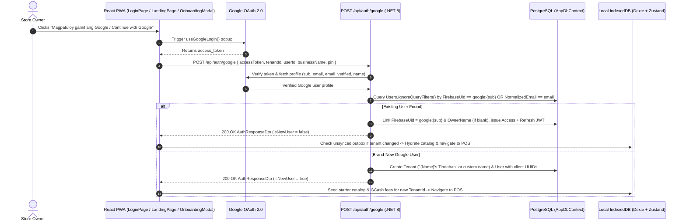

# Google Identity Integration Plan for `fluent-tindahan`

## 1. Project Context & Architecture Overview

`fluent-tindahan` 🛒🇵🇭 is an offline-first Progressive Web App (PWA) and retail management platform tailored for Philippine neighborhood stores (sari-sari stores) and GCash agents.
- **Frontend**: React 19, Vite, TypeScript, Microsoft Fluent UI React v9 (`@fluentui/react-components`), Dexie.js (IndexedDB), and Zustand.
- **Backend**: .NET 8 Clean Architecture (Domain, Application, Infrastructure, WebApi), PostgreSQL 16 (EF Core 8), ASP.NET Core Identity PasswordHasher, and native JWT access/refresh token rotation.

To give store owners total design continuity and offline resilience without iframe glitches or third-party style pollution, Google Sign-Up and Login uses `@react-oauth/google` with its **Custom Hook (`useGoogleLogin`)** tied to a custom Fluent UI v9 `<GoogleAuthButton />`.

---

## 2. Authentication & Provisioning Flow



---

## 3. Configuration & Secrets

### Google Cloud Console OAuth 2.0 Credentials
1. Go to Google Cloud Console > **APIs & Services > Credentials**.
2. Create an **OAuth 2.0 Client ID** (Web application).
3. **Authorized JavaScript origins**:
   - `http://localhost:5173`
   - `http://127.0.0.1:5173`
   - Production URL: `https://tindahan-dev.novastack-inc.online`
4. **Authorized redirect URIs**:
   - `http://localhost:5173`
   - `https://tindahan-dev.novastack-inc.online`

### Environment Variables
- **Frontend** (`.env.example` / `.env`):
  ```env
  VITE_GOOGLE_CLIENT_ID=your-google-client-id.apps.googleusercontent.com
  ```
- **Backend** (`appsettings.json` / environment):
  ```json
  "Google": {
    "ClientId": "your-google-client-id.apps.googleusercontent.com"
  }
  ```

---

## 4. Backend Implementation (`backend/`)

### 1. Verification Service (`IGoogleAuthService` & `GoogleAuthService`)
- Uses standard .NET `HttpClient` (no bulky third-party SDK dependencies).
- When `accessToken` is provided: queries `https://www.googleapis.com/oauth2/v3/userinfo` with `Bearer {accessToken}` to extract `sub`, `email`, `email_verified`, `name`, and `given_name`.
- When `idToken` is provided: queries `https://oauth2.googleapis.com/tokeninfo?id_token={idToken}` and validates `aud` matching configured ClientId.

### 2. Database Mapping (`User` & `Tenant`)
- Stores Google identity in `User.FirebaseUid` formatted as `google:{sub}` without requiring destructive migrations.
- Case-insensitive email lookup uses `User.NormalizedEmail` (standardized by `AuthEmailNormalizer`).
- Supports client-generated UUID primary keys (`Tenant.Id` and `User.Id`) to guarantee zero-conflict offline sync (Rule 5).

### 3. API Endpoint (`POST /api/auth/google`)
- Implemented in `AuthController.cs`.
- **Account Linking**: If an email/password account exists with the same verified email, automatically links `FirebaseUid = google:{sub}` and returns `IsNewUser = false`.
- **New Store Provisioning**: If user is new, creates `Tenant` (defaulting business name to `"{Name}'s Tindahan"` if unspecified) and `User`, sets `IsNewUser = true`, and returns JWT access + refresh tokens.
- **PIN Management**: `PUT /api/auth/pin` supports Google-authenticated owners who have not set a password hash, allowing them to configure or update their quick POS PIN.

---

## 5. Frontend Implementation (`frontend/`)

### 1. OAuth Provider Setup (`App.tsx`)
- Wraps root `<FluentProvider>` with `<GoogleOAuthProvider clientId={clientId}>`.
- Defaults to a placeholder client ID if `VITE_GOOGLE_CLIENT_ID` is unset so the PWA never crashes offline or in testing.

### 2. Reusable Button Component (`<GoogleAuthButton />`)
- Styled using Fluent UI v9 (`makeStyles`, `tokens.*`, `<Button>`, `<Spinner>`).
- Features the official SVG 4-color Google 'G' icon.
- Handles popup loading states, user cancellations, and error toasts gracefully.

### 3. Registration & Store Initialization (`storeRegistration.ts`)
- `executeGoogleAuth`:
  - Generates client UUIDs via `crypto.randomUUID()` for `tenantId` and `userId`.
  - Dispatches `authenticateWithGoogle` payload to backend.
  - If `isNewUser: true`, automatically seeds starter catalog products (`seedDexieDatabaseIfNeeded`) and GCash fee tiers (`useGCashFeeStore`), respecting owner preferences.
  - Protects against cross-tenant data overwrite: verifies `db.syncQueue` and `db.deadLetterQueue` before switching local active store, showing `ConfirmUnsyncedLoginDialog` if dirty local data exists.

### 4. Integration Surfaces
- **`LoginPage.tsx`**: Rendered on both "Mag-login / Log In" and "Magrehistro / Sign Up" tabs with an `"o kaya / or"` divider.
- **`LandingPage.tsx`**: Integrated on hero card quick-access.
- **`OnboardingModal.tsx`**: Offered as a 1-click alternative to manual email/password entry.

---

## 6. Testing Strategy & Verification

### Vitest & Jest Setup (Avoiding Keyborg / JSDOM Script Injection Issues)
In test suites, `@react-oauth/google` is mocked to prevent JSDOM script insertion:
```tsx
vi.mock('@react-oauth/google', () => ({
  GoogleOAuthProvider: ({ children }: { children: React.ReactNode }) => <>{children}</>,
  useGoogleLogin: (options: { onSuccess?: (res: { access_token: string }) => void }) => () => {
    options.onSuccess?.({ access_token: 'mock-google-access-token' });
  },
}));
```

### Automated Validation Commands
```powershell
# Backend unit tests
cd backend
dotnet test --no-restore

# Frontend lint, tests, and build
cd frontend
npm run lint
npm test -- --run
npm run build
```
