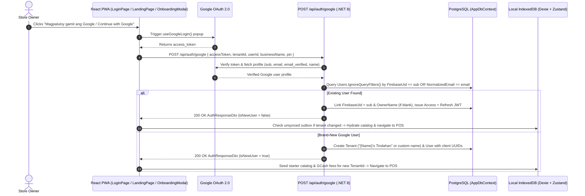

# Implementation Plan: Google Sign-Up & Login (`fluent-tindahan`)

## Goal Description
Enable store owners to **Sign Up** and **Log In** with their Google account across `fluent-tindahan` (`LoginPage`, `LandingPage`, and `OnboardingModal`), while preserving all core architectural invariants:
- **Local-First / Zero Network Block**: New Google store registrations seed local Dexie (`products`, `gcashFeeStore`) using client-generated UUIDs (`tenantId`, `userId`) and log straight into the POS.
- **Automatic Account Linking**: Existing store owners who registered with email/password and subsequently sign in with Google using the same verified email automatically link their Google identity (`sub` stored in `User.FirebaseUid`) and log into their existing store.
- **Cross-Tenant Unsynced Outbox Protection**: Switching into a different tenant via Google Sign-In checks `db.syncQueue` and `db.deadLetterQueue` first and prompts `ConfirmUnsyncedLoginDialog` if unsynced local transactions exist.
- **Root Documentation**: Update [`google_identity_implementation_plan.md`](file:///d:/Projects/fluent-tindahan/google_identity_implementation_plan.md) in the root folder to reflect the exact `.NET 8` Clean Architecture + React 19 / Fluent UI v9 / Zustand / Dexie implementation.

---

## Architecture & Authentication Flow



---

## Proposed Changes

### 1. Root Documentation (`google_identity_implementation_plan.md`)

#### [MODIFY] [google_identity_implementation_plan.md](file:///d:/Projects/fluent-tindahan/google_identity_implementation_plan.md)
- Update the root markdown file so it documents the concrete `fluent-tindahan` architecture:
  - Google Cloud Console OAuth 2.0 setup (`VITE_GOOGLE_CLIENT_ID` in frontend and `Google:ClientId` / `GOOGLE_CLIENT_ID` in backend).
  - Backend verification (`IGoogleAuthService` / `GoogleAuthService` and `POST /api/auth/google` in `AuthController`).
  - Database mapping using `User.FirebaseUid` (`google:{sub}`) and `User.NormalizedEmail` without requiring destructive schema changes.
  - Frontend `<GoogleAuthButton />` integration with Fluent UI v9, `storeRegistration.ts`, `authStore.ts`, and Vitest mocks.

---

### 2. Backend Application & Infrastructure (`backend/`)

#### [NEW] [IGoogleAuthService.cs](file:///d:/Projects/fluent-tindahan/backend/src/FluentTindahan.Application/Common/Interfaces/IGoogleAuthService.cs)
- Define a lean interface for verifying a Google OAuth `accessToken` or `idToken` and returning the verified profile:
```csharp
namespace FluentTindahan.Application.Common.Interfaces;

public sealed record GoogleUserInfo(
    string Subject,
    string Email,
    bool EmailVerified,
    string? FullName,
    string? GivenName
);

public interface IGoogleAuthService
{
    Task<GoogleUserInfo?> VerifyGoogleTokenAsync(
        string? accessToken,
        string? idToken,
        CancellationToken cancellationToken = default);
}
```

#### [NEW] [GoogleAuthService.cs](file:///d:/Projects/fluent-tindahan/backend/src/FluentTindahan.Infrastructure/Services/GoogleAuthService.cs)
- Implement `IGoogleAuthService` using `HttpClient` (standard library, zero extra NuGet bloat):
  - When `accessToken` is provided (from `useGoogleLogin`), call `https://www.googleapis.com/oauth2/v3/userinfo` with `Authorization: Bearer {accessToken}` to retrieve `sub`, `email`, `email_verified`, `name`, and `given_name`.
  - When `idToken` is provided, call `https://oauth2.googleapis.com/tokeninfo?id_token={idToken}` and validate `aud` against configured `Google:ClientId` / `GOOGLE_CLIENT_ID` (when configured) as well as `email_verified`.

#### [MODIFY] [DependencyInjection.cs](file:///d:/Projects/fluent-tindahan/backend/src/FluentTindahan.Infrastructure/DependencyInjection.cs)
- Register `services.AddHttpClient<IGoogleAuthService, GoogleAuthService>();`.

#### [MODIFY] [AuthController.cs](file:///d:/Projects/fluent-tindahan/backend/src/FluentTindahan.WebApi/Controllers/AuthController.cs)
- Inject optional `IGoogleAuthService? googleAuthService = null` into `AuthController` (preserving backward compatibility with existing unit test constructors).
- Add `GoogleAuthRequest` DTO and `IsNewUser` optional property on `AuthResponseDto`:
```csharp
public sealed record GoogleAuthRequest
{
    public string? AccessToken { get; init; }
    public string? IdToken { get; init; }

    [StringLength(200)]
    public string? BusinessName { get; init; }

    [RegularExpression(@"^\d{4,6}$", ErrorMessage = "PIN must be between 4 and 6 digits.")]
    public string? Pin { get; init; }

    public Guid? TenantId { get; init; }
    public Guid? UserId { get; init; }
    public string? RefreshToken { get; init; }
}
```
- Add `[HttpPost("google")]` endpoint (`POST /api/auth/google`):
  1. Validate that either `AccessToken` or `IdToken` is provided and verify via `_googleAuthService.VerifyGoogleTokenAsync(...)`.
  2. Reject if invalid or `!googleUser.EmailVerified` (`401 Unauthorized` with bilingual Tagalog/English message).
  3. Normalize email via `CleanDisplayEmail` and `NormalizeEmail`, and format external subject ID as `google:{googleUser.Subject}`.
  4. Query `_context.Users.IgnoreQueryFilters().Include(u => u.Tenant)` matching `u.FirebaseUid == googleSubject || u.NormalizedEmail == normalizedEmail`.
  5. **Existing User (Login / Account Link)**:
     - If `u.FirebaseUid` is empty, link `user.FirebaseUid = googleSubject`.
     - If `user.OwnerName` is empty and `googleUser.FullName` is present, populate `user.OwnerName`.
     - Issue JWT access token + refresh token and return `AuthResponseDto` (`IsNewUser: false`).
  6. **New User (Sign-Up)**:
     - Determine `businessName`: use `request.BusinessName.Trim()` if provided ($\ge 2$ chars), otherwise default to `$"{givenOrFullName}'s Tindahan"`.
     - Support upgrading an anonymous local placeholder tenant/user if `request.TenantId` exists and belongs to the caller session, or create a new `Tenant` and `User` using client-supplied `TenantId` and `UserId` (Rule 5).
     - Set `user.FirebaseUid = googleSubject`, `user.OwnerName = googleUser.FullName`, `user.PasswordHash = string.Empty`, and optional `user.PinHash` if `request.Pin` was provided.
     - Issue JWT access token + refresh token and return `AuthResponseDto` (`IsNewUser: true`).
- Update `UpdatePin` (`PUT /api/auth/pin`) so Google-registered owners who do not have a `PasswordHash` (`string.IsNullOrEmpty(user.PasswordHash) && !string.IsNullOrEmpty(user.FirebaseUid)`) can set an initial PIN (or update their PIN by providing their current PIN in `request.Password`).

#### [MODIFY] [AuthResponseBuilder.cs](file:///d:/Projects/fluent-tindahan/backend/src/FluentTindahan.WebApi/Controllers/Helpers/AuthResponseBuilder.cs)
- Pass `bool isNewUser = false` to `AuthController.AuthResponseDto`.

---

### 3. Frontend Google OAuth & Local-First Registration (`frontend/`)

#### [MODIFY] [package.json](file:///d:/Projects/fluent-tindahan/frontend/package.json) & [.env.example](file:///d:/Projects/fluent-tindahan/.env.example)
- Add `@react-oauth/google` to `frontend/package.json`.
- Document `VITE_GOOGLE_CLIENT_ID` and `GOOGLE_CLIENT_ID` in `.env.example`.

#### [MODIFY] [App.tsx](file:///d:/Projects/fluent-tindahan/frontend/src/App.tsx)
- Wrap `<FluentProvider>` with `<GoogleOAuthProvider clientId={googleClientId}>` (using `import.meta.env.VITE_GOOGLE_CLIENT_ID || 'fluent-tindahan-google-client-id'`).

#### [MODIFY] [authService.ts](file:///d:/Projects/fluent-tindahan/frontend/src/services/authService.ts)
- Add `isNewUser?: boolean` to `AuthResponseDto`.
- Add `GoogleAuthRequestPayload` and `authenticateWithGoogle(payload: GoogleAuthRequestPayload): Promise<AuthResponseDto>` calling `apiClient.post<AuthResponseDto>('/auth/google', requestPayload)`.

#### [MODIFY] [storeRegistration.ts](file:///d:/Projects/fluent-tindahan/frontend/src/services/storeRegistration.ts)
- Add `executeGoogleAuth(params: ExecuteGoogleAuthParams): Promise<ExecuteStoreLoginResult>`:
  - Generates `newTenantId = createClientUuid()` and `newUserId = createClientUuid()` to pass to `POST /api/auth/google`.
  - Calls `authenticateWithGoogle(...)`.
  - If `authResult.isNewUser` is `true`:
    - Seeds local Dexie catalog (`seedDexieDatabaseIfNeeded`) for `authResult.tenantId` and initializes GCash fee tiers (`useGCashFeeStore`), respecting the `offerGcash` and `includeStarterProducts` toggles.
  - Calls `useAuthStore.getState().loginWithAuthPayload(authResult, localPin, false)`.
  - If `loginRes.success` is `false` (unsynced local items from a previous tenant), returns `{ success: false, unsyncedCount: loginRes.unsyncedCount, authResult, localPin }` so the caller displays `ConfirmUnsyncedLoginDialog`.
  - Otherwise runs `finalizeSuccessfulLogin(authResult.tenantId)` and returns `{ success: true, authResult }`.

#### [NEW] [GoogleAuthButton.tsx](file:///d:/Projects/fluent-tindahan/frontend/src/components/GoogleAuthButton.tsx)
- Reusable Fluent UI v9 button using `useGoogleLogin` from `@react-oauth/google`, with official 4-color Google SVG icon, loading spinner state, accessible label, and error callback handling when Google Client ID is unconfigured or popup is closed.

#### [MODIFY] [LoginPage.tsx](file:///d:/Projects/fluent-tindahan/frontend/src/pages/LoginPage.tsx), [LandingPage.tsx](file:///d:/Projects/fluent-tindahan/frontend/src/pages/LandingPage.tsx), & [OnboardingModal.tsx](file:///d:/Projects/fluent-tindahan/frontend/src/components/OnboardingModal.tsx)
- Render `<GoogleAuthButton />` with a clean `"o / or"` `<Divider>` on both Login and Register tabs.
- When used on the Register tab, pass any user-entered `businessName`, `pin`, `offerGcash`, and `includeStarterProducts` into `executeGoogleAuth` so new stores use those preferences immediately (or default to `"{Name}'s Tindahan"` with starter products when clicked directly).

#### [MODIFY] [translations.ts](file:///d:/Projects/fluent-tindahan/frontend/src/i18n/translations.ts)
- Add Tagalog (`tl`) and English (`en`) strings under `login`:
  - `continueWithGoogle`: `'Magpatuloy gamit ang Google'` / `'Continue with Google'`
  - `signUpWithGoogle`: `'Mag-sign up gamit ang Google'` / `'Sign up with Google'`
  - `orDivider`: `'o kaya'` / `'or'`
  - `googleAuthFailed`: `'Nabigo ang pag-sign in sa Google. Pakisubukan muli.'` / `'Google sign-in failed. Please try again.'`

---

## Verification Plan

### Automated Tests
1. **Backend Unit Tests (`xUnit`)**:
   - Add unit tests in [`AuthControllerTests.cs`](file:///d:/Projects/fluent-tindahan/backend/tests/FluentTindahan.UnitTests/AuthControllerTests.cs) covering:
     - `GoogleAuth_NewUser_ProvisionsTenantAndUserWithClientUuids`
     - `GoogleAuth_NewUserWithoutBusinessName_DefaultsToOwnerNameTindahan`
     - `GoogleAuth_ExistingPasswordUser_LinksFirebaseUidAndLogsIn`
     - `GoogleAuth_ExistingGoogleUser_LogsInAndIssuesTokens`
     - `GoogleAuth_InvalidOrUnverifiedToken_ReturnsUnauthorized`
   - Run:
     ```powershell
     cd backend
     dotnet test --no-restore
     ```
2. **Frontend Lint, Unit Tests & Build (`Vitest` & `TypeScript`)**:
   - Add unit tests in `frontend/src/services/storeRegistration.test.ts` and `frontend/src/pages/LoginPage.test.tsx` mocking `@react-oauth/google` to verify Google sign-up (seeding Dexie + logging in) and Google login (including unsynced queue dialog protection).
   - Run:
     ```powershell
     cd frontend
     npm run lint
     npm test -- --run
     npm run build
     ```

### Manual Verification
1. Start local stack via `.\run-local.cmd`.
2. Open `http://localhost:5173/?tab=login`, verify the "Magpatuloy gamit ang Google / Continue with Google" button appears on both Login and Sign-Up tabs, as well as on the Landing Page hero card and Onboarding Modal.
3. Configure `VITE_GOOGLE_CLIENT_ID` and test signing up with a Google account (auto-provisioning store + starter products) and logging back in.
