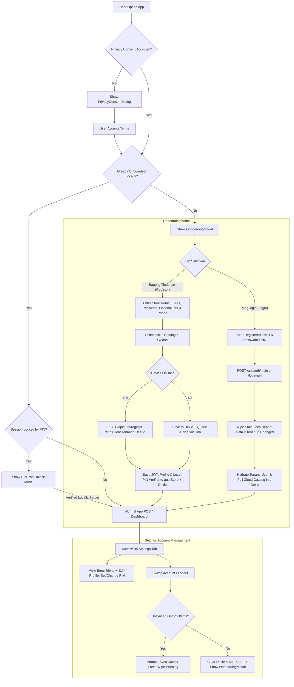

# Implementation Plan: Email-Based Onboarding & Identity Authentication

## Goal Description
Enable store owners to onboard and log into **Fluent Tindahan** using their **email address** as their primary identity, backed by PBKDF2 password authentication, JWT bearer tokens, and a brute-force-protected 4-to-6 digit PIN for rapid in-till unlocking (both online and offline).

Currently, the app initializes tenant and user identities locally with random UUIDs and optional phone numbers without user credentials or a login interface. This refined plan introduces:
1. **Email-Centric Onboarding & Client-Authoritative UUID Registration**: First-time store owners provide their business name, email address, password, and optional fast PIN during initial onboarding while preserving their locally generated `TenantId` and `UserId` to prevent Dexie foreign-key orphaning.
2. **Email & Password Login with Cross-Tenant Data Hygiene**: Existing store owners on new devices or returning sessions can log in using their email address and password to restore their cloud store profile and synchronized catalog, automatically wiping stale local data if switching tenants.
3. **Brute-Force Protected & Offline-Capable Fast PIN Login**: Store owners can configure a 4–6 digit PIN for fast cashier unlocking and local device login, protected by server-side attempt lockouts and a local WebCrypto verifier for offline till unlocking.
4. **Backend Identity & Authentication Endpoints**: Clean Architecture endpoints (`POST /api/auth/register`, `POST /api/auth/login`, `POST /api/auth/login-pin`, `PUT /api/auth/pin`) utilizing ASP.NET Core `PasswordHasher<User>` and `.IgnoreQueryFilters()` for cross-tenant identity resolution.
5. **Multi-Tenant Offline-First Synchronization & Safe Logout**: Preserves the local-first Dexie architecture while guarding against unsynced outbox data loss during account switches or logouts.

---

## User Review Required

> [!IMPORTANT]
> **Authentication Invariants & Offline Resilience**:
> - **Client-Authoritative UUIDs on Registration**: During registration, the client passes its locally generated `tenantId` and `userId` to `POST /api/auth/register`. This guarantees zero foreign-key re-mapping in Dexie when transitioning from offline onboarding to cloud registration.
> - **Unique Normalized Email Index**: A unique index is applied to `NormalizedEmail` (`LOWER(TRIM(Email))`) with a filter (`WHERE "NormalizedEmail" <> ''`) so legacy anonymous device records do not violate uniqueness during migration, while enforcing strict case-insensitive uniqueness across all registered store owners.
> - **EF Core Global Query Filter Bypass (`IMustHaveTenant`)**: Because `User` implements `IMustHaveTenant`, all unauthenticated lookups in `AuthController` (`register`, `login`, `login-pin`) must explicitly apply `.IgnoreQueryFilters()` before a tenant context is established.
> - **PIN Brute-Force & Device Binding**: After **5 failed PIN attempts**, PIN login locks for **15 minutes** (`PinLockoutEnd`) and requires full password re-authentication.
> - **Safe Logout & Tenant Isolation**: Logging out checks the Dexie sync outbox first. If unsynced transactions exist, the UI warns the owner to sync before wiping local store tables (`db.delete()` / table clear).

---

## Architecture & Authentication Flow



---

## Proposed Changes

### 1. Domain & Persistence Layer (`backend/src/FluentTindahan.Domain` & `Infrastructure`)

#### [MODIFY] [`User.cs`](file:///d:/Projects/fluent-tindahan/backend/src/FluentTindahan.Domain/Entities/User.cs)
- Add `Email`, `NormalizedEmail`, `PasswordHash`, `PinHash`, lockout tracking, and audit properties:
```csharp
public class User : IMustHaveTenant
{
    public Guid Id { get; set; } = Guid.NewGuid();
    public Guid TenantId { get; set; }
    public string Email { get; set; } = string.Empty;
    public string NormalizedEmail { get; set; } = string.Empty;
    public string PasswordHash { get; set; } = string.Empty;
    public string? PinHash { get; set; }
    public int FailedPinAttempts { get; set; } = 0;
    public DateTimeOffset? PinLockoutEnd { get; set; }
    public string Phone { get; set; } = string.Empty;
    public string Role { get; set; } = "Owner"; // "Owner", "Staff"
    public string FirebaseUid { get; set; } = string.Empty;
    public DateTimeOffset CreatedAt { get; set; } = DateTimeOffset.UtcNow;
    public DateTimeOffset? LastLoginAt { get; set; }

    public Tenant? Tenant { get; set; }
}
```

#### [MODIFY] [`AppDbContext.cs`](file:///d:/Projects/fluent-tindahan/backend/src/FluentTindahan.Infrastructure/Persistence/AppDbContext.cs)
- Configure EF Core entity mapping for `User`:
  - `builder.Property(u => u.Email).IsRequired().HasMaxLength(256).HasDefaultValue("");`
  - `builder.Property(u => u.NormalizedEmail).IsRequired().HasMaxLength(256).HasDefaultValue("");`
  - `builder.Property(u => u.PasswordHash).IsRequired().HasMaxLength(512).HasDefaultValue("");`
  - `builder.Property(u => u.PinHash).HasMaxLength(512);`
  - Add a **filtered unique index** on `u.NormalizedEmail` for fast, case-insensitive lookups that ignore blank legacy rows:
    ```csharp
    builder.HasIndex(u => u.NormalizedEmail)
           .IsUnique()
           .HasFilter("\"NormalizedEmail\" <> ''");
    ```

#### [NEW] [`20261015220000_AddUserEmailAndPasswordAuth.cs`](file:///d:/Projects/fluent-tindahan/backend/src/FluentTindahan.Infrastructure/Persistence/Migrations/20261015220000_AddUserEmailAndPasswordAuth.cs)
- EF Core migration adding `Email`, `NormalizedEmail`, `PasswordHash`, `PinHash`, `FailedPinAttempts`, `PinLockoutEnd`, and `LastLoginAt` columns to `Users` table with the filtered unique index.

#### [MODIFY] [`DatabaseSeeder.cs`](file:///d:/Projects/fluent-tindahan/backend/src/FluentTindahan.Infrastructure/Persistence/DatabaseSeeder.cs)
- Seed default user with `Email = "nena@fluent-tindahan.ph"`, `NormalizedEmail = "nena@fluent-tindahan.ph"`, and a hashed default password using `PasswordHasher<User>`.

---

### 2. Application & Authentication API Layer (`backend/src/FluentTindahan.WebApi`)

#### [NEW] [`AuthController.cs`](file:///d:/Projects/fluent-tindahan/backend/src/FluentTindahan.WebApi/Controllers/AuthController.cs)
- **Important Query Rule**: All identity queries in `AuthController` must apply `_dbContext.Users.IgnoreQueryFilters().Include(u => u.Tenant)` to bypass multi-tenant global filters prior to authentication.
- Provide endpoints:
  - `POST /api/auth/register`:
    - Accepts `RegisterRequestDto` (`TenantId?`, `UserId?`, `BusinessName`, `OwnerName`, `Email`, `Password`, `Pin?`, `Phone?`, `GcashEnabled`).
    - Validates email format, normalizes via `email.Trim().ToLowerInvariant()`, checks unique constraint across all tenants, validates password length (`>= 6` chars), and validates optional 4–6 digit numeric PIN (`^\d{4,6}$`).
    - Hashes password and PIN using `PasswordHasher<User>`.
    - Upserts `Tenant` and owner `User` preserving client-supplied `TenantId` and `UserId` when provided.
    - Generates JWT bearer token with `sub` (`UserId`), `tenant_id` (`TenantId`), `email`, and `role` claims.
    - Returns `AuthResponseDto` (`tenantId`, `userId`, `email`, `businessName`, `ownerName`, `phone`, `role`, `tier`, `hasPin`, `token`, and `expiresAt`).
  - `POST /api/auth/login`:
    - Queries user by `NormalizedEmail` via `.IgnoreQueryFilters()`.
    - Validates password against stored `PasswordHash` (transparently rehashing if `PasswordVerificationResult.SuccessRehashNeeded`).
    - Resets `FailedPinAttempts = 0` and `PinLockoutEnd = null`, updates `LastLoginAt`.
    - Returns `AuthResponseDto`.
  - `POST /api/auth/login-pin`:
    - Queries user by `NormalizedEmail` via `.IgnoreQueryFilters()`.
    - Checks if `PinLockoutEnd > DateTimeOffset.UtcNow`. If locked out, returns `429 Too Many Requests` with remaining lockout duration.
    - Validates PIN against stored `PinHash`. On failure, increments `FailedPinAttempts` and sets a 15-minute `PinLockoutEnd` on the 5th failed attempt.
    - On success, resets `FailedPinAttempts = 0` and returns `AuthResponseDto`.
  - `PUT /api/auth/pin` (`[Authorize]`):
    - Allows authenticated store owners to set, update, or clear their 4–6 digit PIN from Settings.

#### [MODIFY] [`TenantController.cs`](file:///d:/Projects/fluent-tindahan/backend/src/FluentTindahan.WebApi/Controllers/TenantController.cs)
- Add optional `Email` property to `ProvisionTenantRequest` and update user `Email` / `NormalizedEmail` during standard sync provisioning without overwriting existing non-empty credentials with blank values.

---

### 3. Frontend State, Local Crypto & Dexie Hygiene (`frontend/src/state` & `db`)

#### [MODIFY] [`authStore.ts`](file:///d:/Projects/fluent-tindahan/frontend/src/state/authStore.ts)
- Add state properties and actions:
  - `userEmail: string`
  - `hasPin: boolean`
  - `localPinVerifier: string | null` (salted WebCrypto digest stored locally so cashier PIN unlock works offline)
  - `isSessionLocked: boolean` (enables fast cashier lock screen without wiping local store data)
  - `setUserEmail: (email: string) => void`
  - `setHasPin: (hasPin: boolean) => void`
  - Update `completeOnboarding` and `updateStoreProfile` to accept and persist `userEmail`.
  - `loginWithAuthPayload(payload: AuthResponse, localPin?: string)`:
    - Checks if incoming `payload.tenantId` differs from the active local `tenantId`.
    - If different, wipes local Dexie tenant tables before hydrating new tenant state to prevent cross-tenant data bleed.
    - Atomically persists JWT token, `tenantId`, `userId`, `userEmail`, and `hasPin`.
  - `logout(forceWipe?: boolean)`:
    - Checks pending Dexie sync outbox count. If unsynced records exist and `!forceWipe`, returns a warning state so the UI can prompt the user to sync first.
    - Wipes local Dexie tables, clears tokens, and resets session cleanly.
  - Persist `fluent_tindahan_user_email_v1` and `fluent_tindahan_last_email_v1` in `localStorage`.

---

### 4. Frontend UI Components (`frontend/src/components` & `pages`)

#### [MODIFY] [`OnboardingModal.tsx`](file:///d:/Projects/fluent-tindahan/frontend/src/components/OnboardingModal.tsx)
- Add tabbed interface:
  1. **"Bagong Tindahan" / "Register New Store"**:
     - Store Name (required)
     - Email Address (required, validated format, trimmed & lowercased)
     - Password (required, `>= 6` characters, with show/hide password toggle)
     - Quick PIN (optional, 4–6 numeric digits, `inputMode="numeric"` `pattern="[0-9]*"`)
     - Owner Name (optional)
     - Contact Phone (optional Philippine mobile)
     - Catalog choice & GCash offering
     - Offline fallback support: allows local onboarding to complete if offline and queues cloud account registration when connectivity returns
     - Link to switch to Login tab
  2. **"Mag-login" / "Log In"**:
     - Email Address (pre-populated from `fluent_tindahan_last_email_v1` if available)
     - Mode toggle between **Password** and **Quick PIN**
     - "Mag-login / Log In" button
     - Loading spinner, post-login catalog hydration indicator, and user-friendly error banners (invalid credentials, PIN lockout warning, offline connectivity notice)
     - Link to switch to Registration tab
- Update edit mode (from Settings) to allow editing Store Name, Owner Name, Email, and Phone.

#### [MODIFY] [`SettingsPage.tsx`](file:///d:/Projects/fluent-tindahan/frontend/src/pages/SettingsPage.tsx)
- In the "Account & Tindahan Profile" card:
  - Display the registered `userEmail`.
  - Display Quick PIN status (`Naka-set / Active` vs `Wala / Not Set`) with action to Set/Change PIN.
  - Add **"I-lock ang Kaha (Lock Screen)"** button when PIN is active.
  - Add **"Mag-log In / Magpalit ng Account (Switch Account)"** button to trigger login dialog.
  - Add clean **"Mag-log Out / Log Out"** action with unsynced outbox data warning and confirmation.

#### [MODIFY] [`translations.ts`](file:///d:/Projects/fluent-tindahan/frontend/src/i18n/translations.ts)
- Add comprehensive Tagalog (`tl`) and English (`en`) dictionaries:
  - `emailLabel`, `emailPlaceholder`, `emailRequired`, `emailInvalid`
  - `passwordLabel`, `passwordPlaceholder`, `passwordRequired`, `passwordMinLength`
  - `pinLabel`, `pinPlaceholder`, `pinHint`, `pinInvalid`, `pinLockedError`
  - `registerTab`, `loginTab`, `loginBtn`, `loginSuccess`, `loginFailed`, `emailAlreadyExists`
  - `switchAccountBtn`, `logoutBtn`, `logoutConfirm`, `logoutUnsyncedWarning`, `hydratingStoreData`

---

## Verification Plan

### Automated Tests
1. **Backend Unit Tests (`AuthControllerTests.cs`)**:
   - `Register_ValidRequest_PreservesClientTenantIdAndCreatesUserWithHashedCredentials`
   - `Register_DuplicateEmailDifferentCase_ReturnsConflict`
   - `Login_ValidPassword_BypassesGlobalQueryFilterAndReturnsProfile`
   - `Login_InvalidPassword_ReturnsUnauthorized`
   - `LoginPin_ValidPin_ReturnsSuccess`
   - `LoginPin_FiveFailedAttempts_LocksOutPinAndRequiresPassword`
   - Execution:
     ```powershell
     cd backend
     dotnet test tests/FluentTindahan.UnitTests/FluentTindahan.UnitTests.csproj --no-build
     ```
2. **Frontend Unit & Component Tests**:
   - `authStore.test.ts`: Test saving email, persisting to `localStorage`, cross-tenant Dexie wipe on login, unsynced outbox guard on logout, and offline PIN unlock.
   - `OnboardingModal.test.tsx`: Test email format validation, password strength validation, numeric keypad attributes on PIN input, switching between Register and Login tabs, and submitting registration/login.
   - `SettingsPage.test.tsx`: Test rendering email identity, PIN status, and triggering switch account/logout with unsynced outbox warning.
   - Execution:
     ```powershell
     cd frontend
     npm test -- --run
     npm run lint
     npm run build
     ```

### Manual Verification
1. **Fresh Onboarding & Client UUID Alignment**:
   - Clear browser storage or launch in an incognito window.
   - Accept Privacy Terms.
   - In Onboarding, fill in Store Name, a valid Email (`test@tindahan.ph`), Password (`secret123`), and optional PIN (`1234`).
   - Click "Simulan ang Aking Tindahan".
   - Confirm store launches, dashboard displays store name, Settings shows the email identity, and the local Dexie `tenantId` matches the server response without orphaning seeded products.
2. **Account Switch & Tenant Isolation Flow**:
   - Record a test transaction under `test@tindahan.ph`, then open Settings -> Click "Mag-log Out".
   - In Onboarding/Login dialog, switch to "Mag-login".
   - Enter `nena@fluent-tindahan.ph` and her password.
   - Confirm `test@tindahan.ph` local data is wiped and Nena's store session and products are loaded cleanly.
3. **PIN Login & Brute-Force Lockout**:
   - Attempt to log in with wrong PIN `0000` 5 times and verify the 15-minute lockout message appears.
   - Log in with Password `secret123` to clear the lockout, then log in with PIN `1234` and verify rapid access.