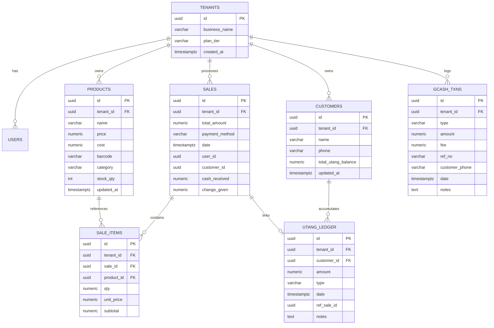

# 🗄️ Database Schemas

Fluent Tindahan coordinates two database layers:
1. **Client Database**: **IndexedDB** managed via **Dexie.js** for zero-latency local operations and offline queuing.
2. **Server Database**: **PostgreSQL 16** managed via **Entity Framework Core 8** for central cloud storage and multi-tenant persistence.

---

## 1. Client-Side Dexie Schema (`db.ts`)

Dexie stores data across 8 core tables:

```typescript
export class FluentTindahanDatabase extends Dexie {
  products!: Table<ProductRecord, string>;
  customers!: Table<CustomerRecord, string>;
  sales!: Table<SaleRecord, string>;
  saleItems!: Table<SaleItemRecord, string>;
  utangLedger!: Table<UtangLedgerRecord, string>;
  gcashTxns!: Table<GCashTxnRecord, string>;
  syncQueue!: Table<SyncQueueRecord, string>;
  deadLetterQueue!: Table<DeadLetterRecord, string>;

  constructor() {
    super('FluentTindahanDb');
    this.version(1).stores({
      products: 'id, tenantId, name, barcode, category, updatedAt',
      customers: 'id, tenantId, name, phone, totalUtangBalance, updatedAt',
      sales: 'id, tenantId, date, paymentMethod, customerId',
      saleItems: 'id, tenantId, saleId, productId',
      utangLedger: 'id, tenantId, customerId, type, date, refSaleId',
      gcashTxns: 'id, tenantId, type, date, refNo',
      syncQueue: 'id, entity, status, retryCount, timestamp',
      deadLetterQueue: 'id, entity, failedAt'
    });
  }
}
```

### Table Definitions & Interfaces

#### Products (`products`)
```typescript
export interface ProductRecord {
  id: string;              // UUID
  tenantId: string;
  name: string;
  price: number;           // Selling price (SRP in PHP)
  cost: number;            // Cost/purchase price
  barcode?: string;        // EAN-13 or custom barcode
  category?: string;       // e.g., 'Instant Noodles', 'Beverages'
  stockQty: number;        // On-hand inventory count
  updatedAt: string;       // ISO 8601 UTC timestamp
}
```

#### Customers & Utang (`customers` & `utangLedger`)
```typescript
export interface CustomerRecord {
  id: string;              // UUID
  tenantId: string;
  name: string;            // Suki customer name
  phone: string;           // Mobile number for SMS contact
  totalUtangBalance: number; // Current outstanding balance in PHP
  updatedAt: string;
}

export interface UtangLedgerRecord {
  id: string;              // UUID
  tenantId: string;
  customerId: string;      // Foreign key -> customers.id
  amount: number;          // Transaction amount in PHP
  type: 'Credit' | 'Payment'; // Credit (utang) or Payment (bayad)
  date: string;            // ISO 8601 UTC timestamp
  refSaleId?: string;      // Associated sale ID if charged via POS
  notes?: string;
}
```

#### POS Sales (`sales` & `saleItems`)
```typescript
export interface SaleRecord {
  id: string;              // UUID
  tenantId: string;
  totalAmount: number;     // Grand total in PHP
  paymentMethod: 'Cash' | 'GCash' | 'Split' | 'Utang';
  date: string;            // ISO 8601 UTC timestamp
  userId: string;          // Cashier/Owner user ID
  customerId?: string;     // Populated if attached to a customer / Utang
  cashReceived?: number;   // Amount handed by customer
  changeGiven?: number;    // Change returned
}

export interface SaleItemRecord {
  id: string;              // UUID
  tenantId: string;
  saleId: string;          // Foreign key -> sales.id
  productId: string;       // Foreign key -> products.id
  productName?: string;    // Snapshot of name at time of sale
  qty: number;             // Quantity sold (supports fractional for weight)
  unitPrice: number;       // Unit price at time of sale
  subtotal: number;        // qty * unitPrice
}
```

#### GCash Log (`gcashTxns`)
```typescript
export interface GCashTxnRecord {
  id: string;              // UUID
  tenantId: string;
  type: 'CashIn' | 'CashOut';
  amount: number;          // Principal remittance amount
  fee: number;             // Convenience service fee charged
  refNo: string;           // GCash reference number (e.g., 901234567890)
  customerPhone?: string;  // Customer mobile number
  date: string;            // ISO 8601 UTC timestamp
  notes?: string;
}
```

---

## 2. Server-Side PostgreSQL Schema (EF Core)

The server database uses PostgreSQL 16 with UUID columns (`uuid_generate_v4()` or .NET `Guid`).



---

## 3. ID Generation & Offline Safety

To avoid sequence conflicts across multiple devices:
- **No auto-incrementing integer IDs**: Neither client nor server uses auto-increment keys.
- **Client-Generated UUIDs**: Every record is generated with a RFC4122 v4 UUID (`crypto.randomUUID()`) when created in the PWA.
- **Idempotency**: Pushing the same sale or ledger mutation twice simply overwrites identical keys safely without duplicate rows.

---

## Related Notes
- [[Offline-First & Sync Engine]] — How queue payloads translate into table inserts.
- [[Point of Sale (POS)]] — Sale item and total calculation logic.
- [[Utang Ledger]] — Balance reconciliation formulas.
