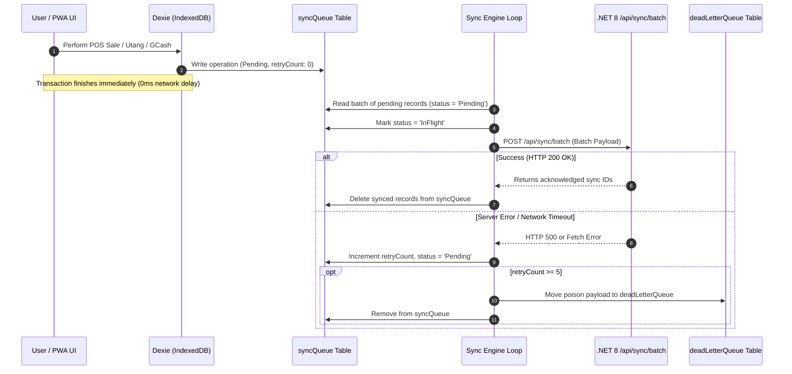

# 🔄 Offline-First & Sync Engine

Fluent Tindahan treats network connectivity as an enhancement rather than a dependency. Store owners can run entire days without an active internet connection; all transactions are recorded locally in **IndexedDB** and synced upstream whenever data connectivity resumes.



---

## 1. Client-Side Mutation Tracking

Whenever a record is created, updated, or deleted in the frontend, two writes occur in a single Dexie transaction:
1. The domain table write (`products`, `sales`, `customers`, etc.).
2. An append to the `syncQueue` table.

### `syncQueue` Record Format
```typescript
export interface SyncQueueRecord {
  id: string; // syncId UUID (client-generated)
  entity: 'Product' | 'Customer' | 'Sale' | 'UtangLedger' | 'GCashTxn';
  action: 'Insert' | 'Update' | 'Delete';
  timestamp: string; // ISO 8601 UTC string
  payload: any;
  status: 'Pending' | 'InFlight' | 'Failed';
  retryCount: number;
  errorMessage?: string;
}
```

---

## 2. Sync Engine Orchestration (`syncEngine.ts`)

The sync engine operates under three triggers:
1. **Window Online Event**: `window.addEventListener('online', () => processSyncQueue())`.
2. **Periodic Polling**: When online, checks every 30 seconds for pending items.
3. **Immediate Push**: Triggered right after a critical transaction if `navigator.onLine` is true.

### Batch Processing Rules
- **Batch Size**: Pushes up to **50 mutations** per HTTP request to keep payload size lightweight for 2G/3G connections.
- **In-Flight Lock**: While a batch is in flight, records are marked `status = 'InFlight'` to prevent duplicate submissions by concurrent sync triggers.
- **Exponential Backoff**: If network or server fails, retry delays scale: `min(1000 * 2^retryCount, 30000)`.

---

## 3. Conflict Resolution Strategy

### A. Last-Write-Wins (LWW) with Timestamp Auditing
- Every mutable entity (`Product`, `Customer`) carries an `updatedAt` ISO 8601 UTC timestamp.
- When the server processes an `Update` action, it compares the incoming payload's `UpdatedAt` with the database record's `UpdatedAt`.
- The most recent timestamp wins.

### B. Append-Only Ledgers (Conflict-Free)
Financial and sales entities (`Sale`, `SaleItem`, `UtangLedger`, `GCashTxn`) are **append-only**. They are never updated or deleted in place, completely eliminating update collisions:
- Every record has a client-generated UUID primary key (`crypto.randomUUID()`).
- The server performs an idempotent insert (`ON CONFLICT (Id) DO NOTHING`).

---

## 4. Poison Pill Prevention & Dead-Letter Queue (DLQ)

If a payload fails repeatedly (e.g. malformed data or server rejection due to constraint violation) it must not block subsequent healthy transactions.

- If `retryCount >= 5`, the engine moves the item into `deadLetterQueue`:
```typescript
export interface DeadLetterRecord {
  id: string; // original syncId
  entity: string;
  action: string;
  timestamp: string;
  payload: any;
  retryCount: number;
  errorMessage?: string;
  failedAt: string;
}
```
- Store owners can view failed items under **Settings > Sync Diagnostics** and manually trigger re-evaluations or export logs for tech support.

---

## 5. Server-Side Batch Handling

The backend exposes `POST /api/sync/batch` handled by MediatR's `ProcessBatchCommand`:
1. Validates the JWT bearer token and extracts `TenantId`.
2. Runs all operations inside an EF Core database transaction.
3. Applies tenant filters to ensure incoming mutations cannot modify other stores' data.
4. Returns an array of processed and acknowledged sync IDs.

---

## Related Notes
- [[Database Schemas]] — Full field-by-field schema breakdown.
- [[PWA & Service Worker]] — Network detection and caching rules.
- [[Utang Ledger]] — Append-only debt tracking mechanics.
- [[Backend Web API]] — Batch endpoint contract and error codes.
