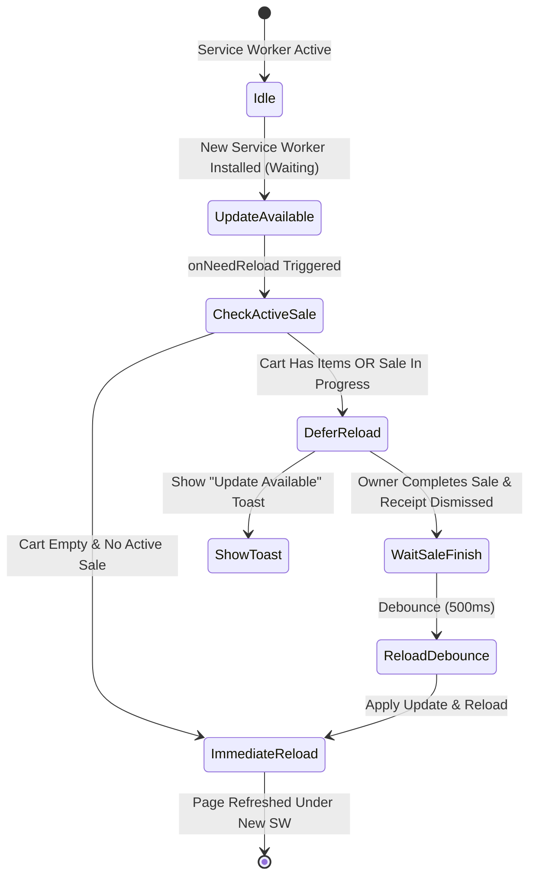

# 📱 PWA & Service Worker Architecture

Fluent Tindahan is built as a production-grade Progressive Web App (PWA) using `vite-plugin-pwa` and **Workbox**. It provides a native app experience on mobile devices and desktops without requiring app store downloads.

---

## 1. Web App Manifest & App Identity

The manifest configuration in `vite.config.ts` defines the installation parameters:

| Property | Value | Notes |
| :--- | :--- | :--- |
| `id` | `/` | Stable app identifier across updates and installs. |
| `name` | `Fluent Tindahan` | Full application name displayed in OS menus. |
| `short_name` | `Tindahan` | Compact name for home screen icons. |
| `start_url` | `/` | Application launch destination. |
| `display` | `standalone` | Launches without browser URL bar or chrome. |
| `theme_color` | `#0f5b34` | Philippine sari-sari store brand green. |
| `background_color`| `#f5f5f5` | Neutral neutral surface background. |

### Icon Assets & Screenshots
- **Icons**: 192x192, 512x512, plus an SVG vector icon with `sizes: 'any'`.
- **Maskable Icons**: Included with safe zones for Android adaptive icons.
- **Screenshots**: High-fidelity UI screenshots for desktop (`wide`) and mobile (`narrow`) richer install dialogs.

---

## 2. Service Worker Lifecycle & Safe Update Deferral

Updating a service worker in a POS application requires extreme care: **reloading a tab while an owner is ringing up a customer or printing a receipt wipes the cart or causes confusion**.

Fluent Tindahan solves this through coordinated update deferral:



### Multi-Tab Coordination (`pwaTabCoordinator.ts`)
When multiple tabs of the POS are open (e.g., one on POS and another checking Inventory):
- Uses `BroadcastChannel('fluent_tindahan_pwa_tabs')` to communicate cart status across tabs.
- If **any** tab reports an open cart (`activeCartItems > 0`) or active sale (`isSaleInProgress`), all tabs defer the service worker reload.
- Once all tabs release their locks, the pending update is applied.

---

## 3. Dynamic Chunk Loading & Preload Error Guard

When a new service worker takes over, older chunk hashes from previous builds may be purged from cache. If an owner navigates to a lazy-loaded route (such as GCash or Inventory):
- A `vite:preloadError` event can occur if the chunk is missing.
- **Fluent Tindahan Protection**:
  1. `event.preventDefault()` suppresses generic browser crash alerts.
  2. If a cart is active, the reload is deferred until the transaction completes.
  3. Includes a cooldown guard (5 seconds) to prevent infinite reload loops if an asset is genuinely missing offline.

---

## 4. Install Prompt UX (`pwaStore.ts`)

- **`beforeinstallprompt`**: Captured and stored in `pwaStore`.
- **Single-Use Guard**: Calling `.prompt()` invalidates the native prompt event. The store immediately sets `deferredPrompt = null` and `isInstallable = false` to prevent subsequent `InvalidStateError` exceptions.
- **Standalone Detection**:
  - Desktop/Android: `window.matchMedia('(display-mode: standalone)').matches`.
  - iOS Safari: `(window.navigator as any).standalone === true`.
  - Separate `isInstalled` flag ensures the tab doesn't prematurely report itself as standalone while still running inside a browser tab.

---

## 5. Development Mode vs Production

By default, Vite development server disables the service worker (`devOptions.enabled = false`) so developers do not battle stale caches during API and UI iteration.

To test the PWA service worker locally:
```bash
# Preview build (recommended)
npm run build && npm run preview

# Dev mode with PWA enabled
$env:PWA_DEV="true"; npm run dev
```

---

## Related Notes
- [[System Architecture]] — Client-side system overview.
- [[Point of Sale (POS)]] — In-transaction state protection rules.
- [[Testing & QA Workflow]] — Multi-tab and offline verification procedures.
