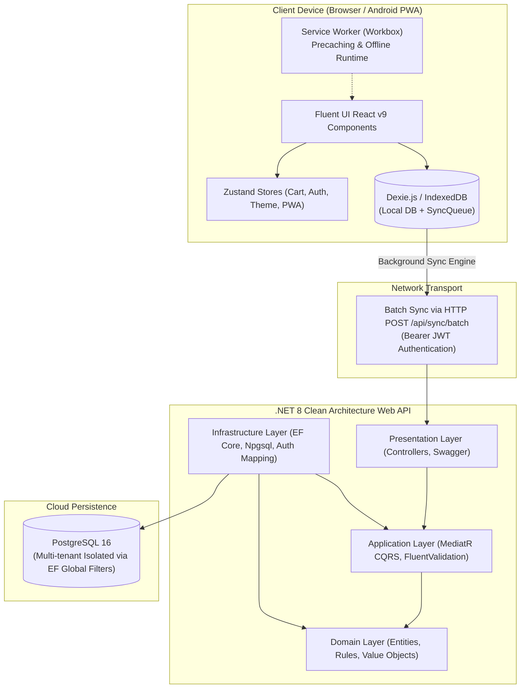

# 📐 System Architecture

Fluent Tindahan is an **offline-first distributed POS & retail management platform**. It pairs a client-side Progressive Web App (PWA) with a .NET 8 Clean Architecture backend to guarantee uninterrupted operation on low-end hardware in areas with unstable or non-existent mobile internet.



---

## Architectural Principles

### 1. Local-First Operations
The store owner should never be blocked by a spinning loader or network error while transacting. Every single user action—adding an item to cart, checking out a sale, recording an utang credit, or logging a GCash transaction—writes immediately to local **IndexedDB** through [[Database Schemas|Dexie.js]].

### 2. Multi-Tenant by Design
Data is isolated per `TenantId`. In the backend, multi-tenancy is enforced at the database query level using **EF Core Global Query Filters**:
```csharp
modelBuilder.Entity<Product>()
    .HasQueryFilter(p => p.TenantId == _currentUserService.TenantId);
```

### 3. Clean Architecture (.NET 8)
The backend decouples business rules from database access and UI frameworks:
- **`FluentTindahan.Domain`**: Core entities (`Tenant`, `Product`, `Customer`, `Sale`, `UtangLedger`, `GCashTxn`). Zero external dependencies.
- **`FluentTindahan.Application`**: Use cases, CQRS commands/queries (`ProcessBatchCommand`, `GetDashboardMetricsQuery`), validation handlers via `FluentValidation`.
- **`FluentTindahan.Infrastructure`**: EF Core `DbContext`, PostgreSQL provider (`Npgsql`), mapping Firebase UIDs to PostgreSQL tenants.
- **`FluentTindahan.WebApi`**: ASP.NET Core controllers, middleware, Swagger OpenAPI, and health check endpoints.

---

## Key Components

| Layer / Component | Technology | Responsibility |
| :--- | :--- | :--- |
| **PWA Client** | React 18, Vite, TypeScript | Interactive UI, local persistence, barcode scanning, PWA install lifecycle. |
| **Design System** | Fluent UI React v9 (`@fluentui/react-components`) | Accessible Microsoft Fluent 2 design language, custom brand tokens, Griffel CSS-in-JS. |
| **Local Database** | Dexie.js (IndexedDB wrapper) | Client relational storage for 1,000s of products, sales records, and `syncQueue`. |
| **Background Sync** | Custom `syncEngine.ts` | Gathers pending mutations from Dexie, pushes batches to server with retry backoff. |
| **Service Worker** | `vite-plugin-pwa`, Workbox | Pre-caches HTML/CSS/JS, manages offline asset delivery, updates without tearing open sales. |
| **Backend API** | ASP.NET Core 8 (.NET 8) | High-performance, concurrent processing of batched sync payloads. |
| **Database** | PostgreSQL 16 | Relational data persistence with UUID primary keys and JSONB payload auditing. |

---

## Related Notes
- [[Offline-First & Sync Engine]] — Detailed sync protocol and conflict resolution.
- [[PWA & Service Worker]] — Service worker lifecycle, multi-tab coordination, and update management.
- [[Database Schemas]] — Detailed comparison of Dexie and PostgreSQL schemas.
- [[Backend Web API]] — MediatR CQRS handlers and controller specifications.
- [[Frontend Architecture & State]] — React component tree, Zustand stores, and Griffel tokens.
