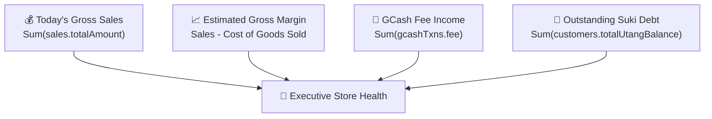

# 📊 Dashboard & Analytics

The Dashboard (`DashboardPage.tsx`) provides store owners with an executive snapshot of store performance, financial liquidity, and urgent inventory alerts.

---

## 1. Primary Store KPI Tiles

The dashboard aggregates data in real-time from IndexedDB and server queries:

| Metric Tile | Computation Formula | Purpose |
| :--- | :--- | :--- |
| **Today's Sales** | `Sum(SaleRecord.totalAmount)` for `date = today` | Cash flow velocity and sales volume. |
| **Gross Margin** | `Sales - Sum(SaleItem.qty * Product.cost)` | True take-home earnings before store operating expenses. |
| **GCash Fee Earnings** | `Sum(GCashTxnRecord.fee)` | Auxiliary service profit from cash remittance operations. |
| **Active Utang Receivables** | `Sum(CustomerRecord.totalUtangBalance)` | Store capital currently tied up in neighborhood credit. |
| **Low Stock Count** | `Count(Product where stockQty <= reorderLevel)` | Items requiring replenishment on the next market run. |

---

## 2. Quick Action Launcher

Located at the top of the dashboard for touch efficiency:
- **`Benta (POS)`**: Launches POS terminal.
- **`Magpalista (Utang)`**: Directly opens customer credit dialog.
- **`GCash Transact`**: Opens Cash-In/Cash-Out modal.
- **`Magdagdag ng Paninda`**: Opens new SKU modal.

---

## 3. Fast-Moving Items & Category Breakdown

Visualizes which FMCG categories drive the highest revenue:
1. **Instant Noodles & Canned Goods** (High velocity, consistent baseline margin ~15-20%).
2. **Coffee & Beverages** (Frequent morning/afternoon purchases, margin ~20-25%).
3. **Tingi Items** (High gross margin ~30-40%).
4. **Cigarettes** (High volume, low percentage margin ~10-15%).

---

## Related Notes
- [[Point of Sale (POS)]] — Sale event data source.
- [[Inventory & Tingi]] — Stock thresholds and margin calculations.
- [[Utang Ledger]] — Receivables data source.
- [[GCash Agent System]] — Fee income data source.
