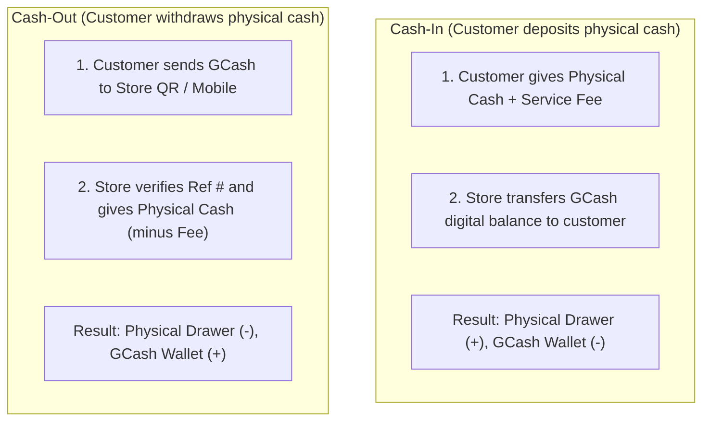

# 📱 GCash Agent System

In almost every Philippine barangay, sari-sari stores serve as neighborhood financial kiosks. Residents use their local tindahan to send money to family (**Cash-In**) or withdraw remittance received via mobile wallets (**Cash-Out**).

Fluent Tindahan provides a specialized ledger to track transaction fees, prevent reconciliation errors, and log reference numbers for dispute resolution.

---

## 1. Cash-In vs Cash-Out Mechanics

| Dimension | Cash-In | Cash-Out |
| :--- | :--- | :--- |
| **Customer Action** | Brings physical peso bills to the store. | Sends digital balance to the store's GCash number. |
| **Store Action** | Transfers digital money from store app to customer. | Hands physical peso bills to the customer. |
| **Physical Drawer Effect**| **Increases (+ Cash)** | **Decreases (- Cash)** |
| **GCash Wallet Effect** | **Decreases (- Digital)** | **Increases (+ Digital)** |
| **Fee Collected** | Collected in physical cash or deducted from remittance. | Deducted from cash payout or paid separately. |

---

## 2. Standard Convenience Fee Schedule

Stores set convenience fees based on transaction tiers. Fluent Tindahan auto-calculates the recommended fee based on standard neighborhood practices:

| Amount Bracket | Standard Neighborhood Fee | Alternative % Model |
| :--- | :--- | :--- |
| ₱1 — ₱500 | **₱10.00** | 2% (min ₱10) |
| ₱501 — ₱1,000 | **₱15.00 — ₱20.00** | 2% |
| ₱1,001 — ₱2,000 | **₱30.00 — ₱40.00** | 2% |
| ₱2,001 — ₱5,000 | **₱50.00 — ₱80.00** | 1.5% — 2% |
| > ₱5,000 | **₱100.00+** | 1.5% — 2% |

Store owners can override the automated fee directly on the screen (`GCashPage.tsx`).

---

## 3. Reference Number Audit Log

Fraud and disputes frequently occur when customers claim to have sent funds that did not reflect.
- The `refNo` field enforces entering GCash's SMS/App reference code (e.g. `901234567890`).
- Prevents duplicate entry of identical reference numbers within the store tenant.
- Facilitates immediate search when a customer returns regarding a disputed transaction.

---

## 4. End-of-Day Float Reconciliation

At closing, the store owner must balance two separate floats:
1. **Physical Cash Drawer Float**: `Opening Cash + Cash Sales + Cash-In Received - Cash-Out Paid = Expected Cash`.
2. **GCash Digital Float**: `Opening Digital - Cash-In Sent + Cash-Out Received = Expected Digital`.
3. **Total Profit from Fees**: `Sum(fee)` logged as pure service revenue.

---

## Related Notes
- [[Point of Sale (POS)]] — Using GCash as a payment method for merchandise.
- [[Dashboard & Analytics]] — Viewing daily fee earnings and transaction volume.
- [[Database Schemas]] — GCash transaction table structure.
