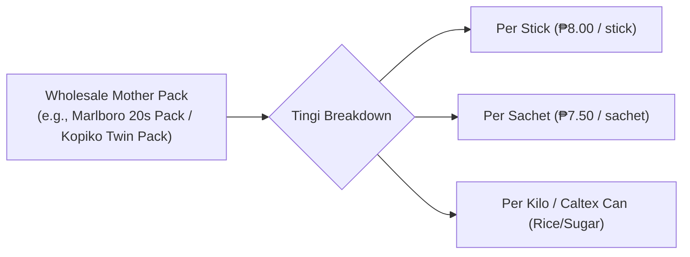

# 📦 Inventory & Tingi Management

Managing inventory in a Philippine sari-sari store requires handling both standard wholesale packaging and **"tingi"** (fractional/repackaged retail).

---

## 1. The "Tingi" Retail Mechanism

Filipino consumers often buy daily necessities in single-use or small unit increments due to daily cash flow constraints.

### Margin Multipliers in Tingi
Tingi items yield substantially higher gross profit margins for the store owner than selling wholesale units, compensating for the manual labor of repackaging:

| Product Type | Wholesale Cost | Bulk SRP | Tingi SRP Breakdown | Tingi Gross Margin |
| :--- | :--- | :--- | :--- | :--- |
| **Cigarettes (20s pack)** | ₱145.00 / pack | ₱165.00 | 20 sticks @ ₱9.00 = **₱180.00** | **+24.1%** (vs +13.7% bulk) |
| **Kopiko Twin Pack (52g)** | ₱12.20 / pack | ₱15.00 | 2 sachets @ ₱8.00 = **₱16.00** | **+31.1%** (vs +22.9% bulk) |
| **Cooking Oil (1 Liter)** | ₱70.00 / bottle | ₱82.00 | 5 plastic ice bags @ ₱18.00 = **₱90.00** | **+28.5%** (vs +17.1% bulk) |

---

## 2. Default Sari-Sari Catalog

Fluent Tindahan ships with a pre-configured database of **138 authentic Philippine store items**:
- **Instant Noodles**: Lucky Me! (Kalamansi, Chili Mansi, Extra Hot, Sweet & Spicy, Mami Chicken/Beef), Payless Extra Big, Nissin Cup Noodles.
- **Coffee & Beverages**: Kopiko (Blanca, Black, Brown, Cappuccino), Nescafé (Classic, 3-in-1), Great Taste White, Milo.
- **Milk & Dairy**: Bear Brand Fortified, Birch Tree, Alaska Evap & Condensada.
- **Canned Goods**: Century Tuna, Argentina Corned Beef, 555 Sardines, San Marino Corned Tuna, Ligo Sardines.
- **Snacks & Biscuits**: Piattos, Chippy, Nova, Oishi Prawn Crackers, SkyFlakes, Fita, Rebisco.
- **Condiments**: Datu Puti Vinegar/Soy Sauce, Silver Swan, Mang Tomas, Magic Sarap sachets.
- **Personal Care**: Palmolive, Sunsilk, Head & Shoulders, Safeguard, Surf / Ariel / Tide single-wash sachets.
- **Rice & Essentials**: Dinorado, Sinandomeng, Well-milled rice, Refined sugar, Brown sugar.

---

## 3. CSV Import & Bulk Synchronization (`ImportPage.tsx`)

Store owners can bulk-import or export catalogs via CSV:
- **Columns**: `barcode`, `product_name`, `brand`, `category`, `package_size`, `unit`, `cost_price_php`, `srp_php`, `stock_quantity`, `reorder_level`, `is_tingi`.
- **Validation**: Automatically validates barcode integrity (EAN-13), identifies duplicate items, and skips corrupt rows while reporting errors.
- **Offline Seed**: When the app boots on a fresh device for the first time, `seedData.ts` populates Dexie with the default catalog in < 200ms.

---

## 4. Reorder Alerts & Low Stock Monitoring

- Each product defines a `reorder_level` (e.g. minimum 6 sachets).
- When a POS sale decrements `stockQty` below the threshold, the item is tagged with a `Low Stock` warning badge and surfaced on the [[Dashboard & Analytics]] screen.

---

## Related Notes
- [[Point of Sale (POS)]] — How inventory decrements upon checkout.
- [[Product Catalog Reference]] — Full list of supported FMCG brands.
- [[Philippine Retail Culture]] — Cultural context of tingi micro-purchases.
