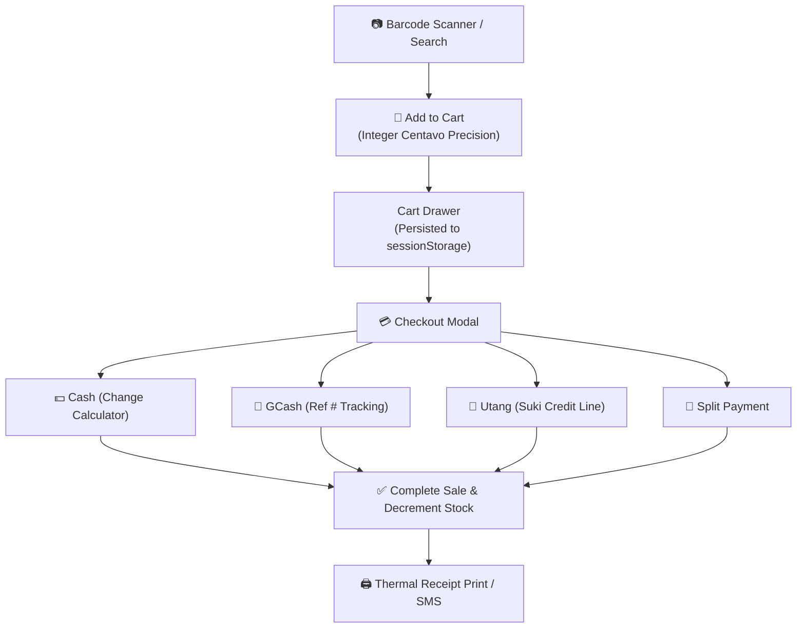

# 🛒 Point of Sale (POS)

The Point of Sale module is the central interface of Fluent Tindahan. Designed specifically for fast, high-volume transactions in neighborhood stores, it supports touch-first operation on Android tablets, mobile phones, and desktop PCs.



---

## 1. Barcode Scanning & Item Lookup

The POS supports three methods of item entry:
1. **Hardware USB / Bluetooth Barcode Scanners**: Listens to raw `keydown` events. Rapid keystrokes ending with an `Enter` key automatically identify and append the scanned barcode to the cart without requiring input field focus.
2. **Camera Scanner (`BarcodeScannerModal.tsx`)**: Utilizes the device camera via the HTML5 Barcode Detection API or ZXing library to scan EAN-13 barcodes on packaged goods.
3. **Touch Grid & Search**: Fast text filtering with category tabs (Instant Noodles, Beverages, Canned Goods, Tingi, etc.).

---

## 2. Cart Calculation & Centavo Precision

JavaScript floating-point arithmetic can produce drift (e.g., `0.1 + 0.2 = 0.30000000000000004`). In a retail till, even a single centavo discrepancy damages trust.

The POS store (`cartStore.ts`) enforces integer centavo calculations:
```typescript
// Calculation in integer centavos
const unitPriceCentavos = Math.round(product.price * 100);
const subtotalCentavos = unitPriceCentavos * item.quantity;
const totalCentavos = items.reduce((acc, item) => 
  acc + Math.round(item.price * 100) * item.quantity, 0);

const totalAmount = totalCentavos / 100;
```

---

## 3. Cart Crash & Reload Persistence

To protect active transactions against accidental browser refreshes, battery exhaustion, or background tab discards:
- The cart store syncs state to browser storage (`sessionStorage` / Dexie).
- If the browser restarts mid-transaction, the open cart is restored immediately upon opening the app.
- When an active cart exists, the [[PWA & Service Worker]] explicitly defers any pending application updates to prevent tearing down the sale.

---

## 4. Payment Methods & Checkout Flow

| Payment Method | Operational Behavior |
| :--- | :--- |
| **Cash** | Cashier inputs amount received; real-time change calculation displayed in large bold text (e.g., `₱1,000 received - ₱245 total = ₱755 change`). |
| **GCash** | Records the customer's GCash mobile number and reference number. Optionally logs an automated service fee if applicable. |
| **Utang (Credit)** | Prompts for a registered customer. Appends a `Credit` entry to the [[Utang Ledger]] and updates the customer's running debt balance. |
| **Split Payment** | Allows partial cash and partial GCash/Utang for larger orders. |

---

## 5. Sale Completion & Receipt Generation

Upon confirming checkout:
1. A new `SaleRecord` and corresponding `SaleItemRecord` entries are generated with client UUIDs.
2. The product's `stockQty` is decremented in Dexie's `products` table.
3. Mutations are queued in `syncQueue` for upstream synchronization.
4. A 58mm/80mm thermal receipt dialog is rendered (see [[Thermal Printing & Hardware]]).

---

## Related Notes
- [[Inventory & Tingi]] — Product catalog management and stock levels.
- [[Utang Ledger]] — Managing customer credit lines.
- [[GCash Agent System]] — Remittance and wallet reconciliation.
- [[Thermal Printing & Hardware]] — ESC/POS printing drivers.
- [[PWA & Service Worker]] — Multi-tab update safety during active sales.
