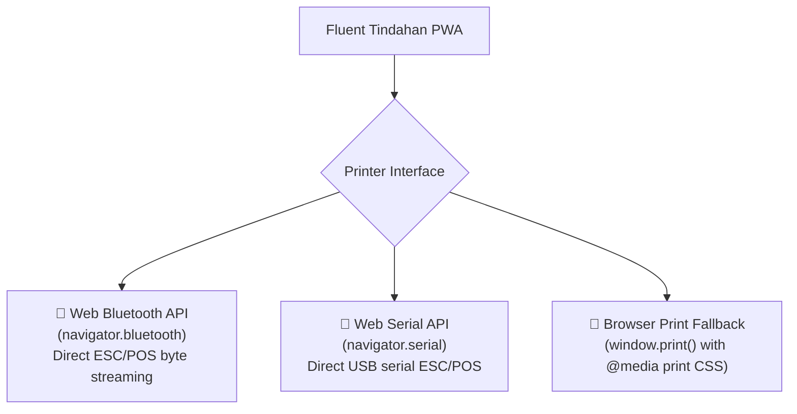

# 🖨️ Thermal Printing & Hardware Integration

Small retail stores frequently rely on affordable 58mm or 80mm ESC/POS thermal printers connected via Bluetooth or USB to print customer receipts and debt payment slips.

---

## 1. Supported Connection Modes

Fluent Tindahan integrates hardware printers through modern Web APIs:



1. **Web Bluetooth API**: Connects wirelessly to portable battery-powered thermal printers (e.g. GOOJPRT, MPT-II, Zjiang).
2. **Web Serial API**: Connects to desktop USB POS printers on Windows/ChromeOS without installing manufacturer driver bloatware.
3. **Browser Print Fallback**: Standard browser print dialog formatted cleanly for roll thermal paper.

---

## 2. ESC/POS Command Protocol

Direct printing formats receipts using ESC/POS byte sequences:

| Command | Hex Bytes | Description |
| :--- | :--- | :--- |
| **Initialize** | `0x1B, 0x40` | Resets printer buffer and default styles. |
| **Center Align** | `0x1B, 0x61, 0x01` | Centers store header and footer text. |
| **Left Align** | `0x1B, 0x61, 0x00` | Aligns itemized line items. |
| **Bold On / Off** | `0x1B, 0x45, 0x01` / `0x00` | Toggles bold font for totals. |
| **Double Height** | `0x1D, 0x21, 0x01` | Enlarges store title. |
| **Paper Feed & Cut**| `0x1D, 0x56, 0x41, 0x10` | Feeds paper and performs full or partial cut. |

---

## 3. Receipt Layout Specifications

Receipts support both **58mm (32 characters / line)** and **80mm (48 characters / line)** formats.

### Sample 58mm POS Receipt
```text
================================
         ALING NENA'S
       SARI-SARI STORE
   Brgy. San Antonio, Pasig
     Tel: 0917-123-4567
================================
Date: 2026-10-10 14:32  Txn: #8F2A
Cashier: Jonathan
--------------------------------
ITEM               QTY    AMOUNT
Lucky Me Kalamansi   2     32.00
Kopiko Blanca TP     1     15.00
Marlboro Red (stick) 3     27.00
--------------------------------
TOTAL ITEMS: 3
SUBTOTAL:                 ₱74.00
--------------------------------
TOTAL AMOUNT:             ₱74.00
CASH RECEIVED:           ₱100.00
CHANGE GIVEN:             ₱26.00
================================
      Salamat sa Pagbili!
    Balik po kayo muli!
================================
```

---

## Related Notes
- [[Point of Sale (POS)]] — Checkout receipt trigger.
- [[Utang Ledger]] — Resibo ng Bayad (payment acknowledgment slip).
- [[Frontend Architecture & State]] — `printerStore.ts` configuration.
