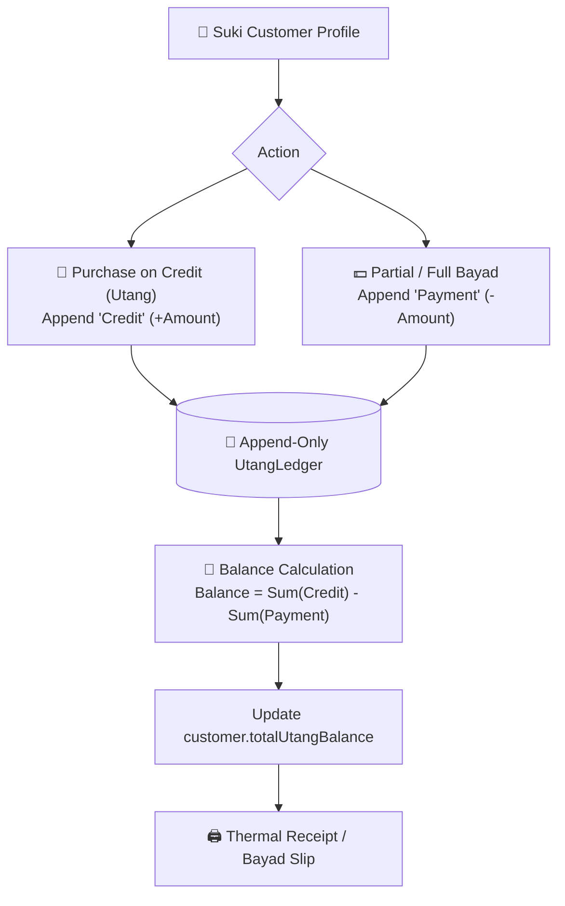

# 📒 Utang Ledger (Customer Credit)

In Philippine sari-sari stores, **"Utang"** (informal consumer credit) is an indispensable social and economic institution. Store owners extend short-term micro-credit to trusted neighborhood patrons (**"suki"**) to be settled on paydays ("kinsenas / katapusan").

Historically kept in a worn physical notebook (*"listahan sa kwaderno"*), Fluent Tindahan digitizes this ledger while preserving the simplicity and mutual trust of the neighborhood relationship.



---

## 1. Ledger Data Mechanics

The ledger is strictly **append-only** to ensure an indisputable audit trail:
- Ledger records are never modified or deleted in place.
- Corrections are made by appending compensating entries.

```typescript
export interface UtangLedgerRecord {
  id: string;              // UUID
  tenantId: string;
  customerId: string;      // FK to customers table
  amount: number;          // PHP amount (positive number)
  type: 'Credit' | 'Payment'; // Credit (utang) | Payment (bayad)
  date: string;            // ISO 8601 UTC timestamp
  refSaleId?: string;      // Linked POS Sale ID (if charged at checkout)
  notes?: string;          // e.g., "Paid 500, promised balance on Friday"
}
```

---

## 2. Customer Credit Lifecycle

### A. Customer Onboarding
- Fields: `name`, `phone`, initial balance (if migrating from a paper notebook).
- Under the Philippine Data Privacy Act ([[Security & Privacy (RA 10173)]]), phone numbers are stored strictly for store communication and collection notices.

### B. Charging to Utang at Checkout
1. In the [[Point of Sale (POS)]], cashier chooses payment method **Utang**.
2. Selects or searches the customer by name or phone.
3. System verifies customer status.
4. Completes sale:
   - Appends a `Credit` record to `utangLedger` with `refSaleId`.
   - Increments `customer.totalUtangBalance`.

### C. Recording Payments ("Bayad")
1. In `UtangPage.tsx`, cashier opens the customer ledger.
2. Enters repayment amount and notes.
3. Appends a `Payment` record to `utangLedger`.
4. Decrements `customer.totalUtangBalance`.
5. Can trigger printing of an official acknowledgment receipt (*"Resibo ng Bayad"*).

---

## 3. Aging & Collection Alerts

The dashboard flags overdue credit balances:
- **Current (0 - 15 days)**: Healthy credit within typical payroll cycles.
- **Due (16 - 30 days)**: Highlighted in amber.
- **Overdue (> 30 days)**: Flagged in red; prompts store owner before extending further credit.

---

## Related Notes
- [[Point of Sale (POS)]] — Charging POS carts directly to customer credit.
- [[Database Schemas]] — Detailed schema of `customers` and `utangLedger`.
- [[Philippine Retail Culture]] — Social dynamics of utang in barangays.
- [[Security & Privacy (RA 10173)]] — Customer contact info compliance.
