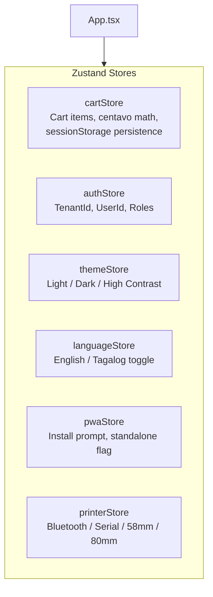

# 🎨 Frontend Architecture & State

The frontend is a touch-optimized Single Page Application (SPA) and PWA built with **React 18**, **Vite**, **TypeScript**, and Microsoft's **Fluent UI React v9**.

---

## 1. UI Design System: Fluent UI React v9

All UI components and layouts are built using Microsoft Fluent 2:
- `@fluentui/react-components`: Core components (`Button`, `Dialog`, `Input`, `Card`, `Badge`, `Drawer`, `Toast`).
- `@fluentui/react-icons`: Fluent System Icons.
- **Griffel (`makeStyles`)**: Atomic CSS-in-JS engine with zero runtime overhead in production.

### Brand Theme Customization
The app is wrapped in `FluentProvider` with a customized brand palette centered around Philippine tindahan green:
```typescript
import { createDarkTheme, createLightTheme, BrandVariants } from '@fluentui/react-components';

const tindahanBrand: BrandVariants = {
  10: '#020d07',
  20: '#061a0f',
  // ...
  80: '#0f5b34', // Primary Tindahan Green
  // ...
  160: '#d7f7e4',
};
```

---

## 2. State Management Architecture (Zustand)

Global client state is partitioned into specialized Zustand stores:



### Store Responsibilities

| Store | File | Core Responsibilities |
| :--- | :--- | :--- |
| **`useCartStore`** | `src/state/cartStore.ts` | Items in current cart, quantity changes, integer centavo pricing, reload protection. |
| **`useAuthStore`** | `src/state/authStore.ts` | Current user profile, tenant ID, permissions, login state. |
| **`useThemeStore`** | `src/state/themeStore.ts` | Theme switching (Web Light, Web Dark, High Contrast, Brand Customization). |
| **`useLanguageStore`** | `src/state/languageStore.ts`| Locale toggle between `en` (English) and `fil` (Tagalog/Filipino). |
| **`usePwaStore`** | `src/state/pwaStore.ts` | Install prompt tracking, standalone mode detection, update availability state. |
| **`usePrinterStore`** | `src/state/printerStore.ts`| Thermal printer driver selection, paper size (58mm vs 80mm), connection state. |

---

## 3. Directory Layout

```text
frontend/src/
├── components/     # Reusable UI widgets (Header, Navigation, BarcodeScannerModal, PwaUpdateToast)
├── db/             # Dexie.js database instance, schemas, seed data
├── i18n/           # English and Tagalog translation dictionaries
├── pages/          # Top-level route views (POS, Inventory, Utang, GCash, Dashboard, Settings, Import)
├── pwa/            # Service worker registration and multi-tab coordinator
├── services/       # HTTP API clients and CSV parser
├── state/          # Zustand store definitions and unit tests
├── sync/           # Background offline sync engine
├── theme/          # Fluent UI v9 brand tokens and theme definitions
└── utils/          # Sound effects (audio beeps for barcode scan), currency formatters
```

---

## Related Notes
- [[Point of Sale (POS)]] — Cart interaction details.
- [[PWA & Service Worker]] — Update coordination and tab sync.
- [[Internationalization (i18n)]] — Localization details.
