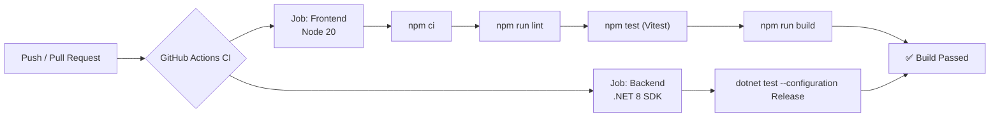
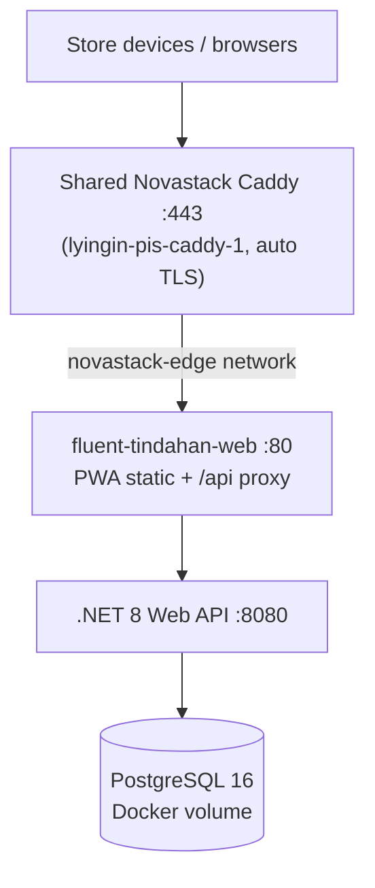
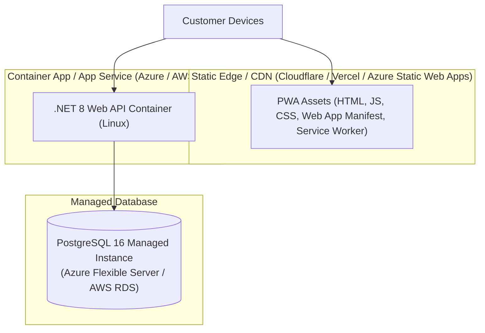

# 🚀 CI-CD & Deployment

This document covers continuous integration pipelines, automated quality gates, and target production deployment architectures (including Alibaba Cloud Simple Application Server).

---

## 1. Continuous Integration (`ci.yml`)

Every push and pull request to `main` and `pwa` triggers the GitHub Actions CI pipeline:



### Pipeline Jobs:
1. **Frontend Job**:
   - Ubuntu runner with Node.js 20.
   - Dependency verification (`npm ci`).
   - Linting check (`npm run lint`).
   - Unit test execution (`npm test`).
   - Production Vite PWA build (`npm run build`).
2. **Backend Job**:
   - Ubuntu runner with .NET 8.0.x SDK.
   - Runs unit tests in Release mode (`dotnet test`).

---

## 2. Alibaba Cloud Simple Application Server (SAS) — Novastack Standard

Primary production path for Novastack apps: one SAS instance running Docker Compose.



### Deploy target
| | |
| --- | --- |
| Public URL | `https://tindahan-dev.novastack-inc.online` |
| SAS host | `8.220.128.80`, install dir `/opt/fluent-tindahan` |
| Host port | `127.0.0.1:8089` (other apps: 8085–8088, 8090, 8095, 8096, 43123) |

```powershell
# first deploy only: PayMongo keys pushed into the server .env
copy deploy\alibaba-sas\secrets.env.example deploy\alibaba-sas\secrets.env

.\deploy-alibaba-sas.cmd                      # first time on this server: add -ModifyDockerCaddy
```

| Piece | Role |
| --- | --- |
| `deploy-alibaba-sas.cmd` | One-step launcher (root password once) |
| `deploy/alibaba-sas/Deploy-NovastackSas.ps1` | Packages the repo and streams it over a single SSH session |
| `deploy/alibaba-sas/install.sh` | Generates/updates the server `.env`, runs `deploy.sh`, adds the domain to Caddy |
| `deploy/alibaba-sas/deploy.sh` | Secret checks, `pg_dump` snapshot, build, `up -d`, health wait |
| `deploy/alibaba-sas/docker-compose.sas.yml` | SAS overlay: container names, memory limits, `novastack-edge` network |
| `deploy/nginx/default.conf` | App-container SPA fallback + `/api` reverse proxy |

Open TCP **80** and **443** in the SAS Firewall console. Health probe: `GET /api/health`. Full runbook (DNS, options, restore): `deploy/alibaba-sas/README.md`.

### Database Backups (pg_dump)
Every deploy writes `/opt/fluent-tindahan/backups/db_YYYYMMDD_HHMMSS.sql.gz` before rebuilding and aborts if the snapshot fails (`-NoBackup` skips it). Restore steps are in `deploy/alibaba-sas/README.md`.

### Local Docker parity
```powershell
.\run-local.cmd -Docker      # or ./run-local.sh --docker
# PWA http://localhost:8080  ·  API http://localhost:5000  ·  Postgres :5432
```

---

## 3. Alternate Hosting Architecture (CDN + managed DB)



### Hosting Strategy:
- **PWA Frontend**: Hosted as static assets on a global CDN when you outgrow single-node SAS.
- **Backend Web API**: Packaged as a lightweight Linux container (`mcr.microsoft.com/dotnet/aspnet:8.0`).
- **PostgreSQL**: Managed PostgreSQL 16 with daily automated backups.

---

## Related Notes
- [[Getting Started & Local Setup]] — Local development environment.
- [[Testing & QA Workflow]] — Running the local test suites.
- [[System Architecture]] — System component overview.
