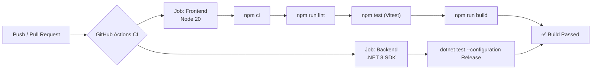
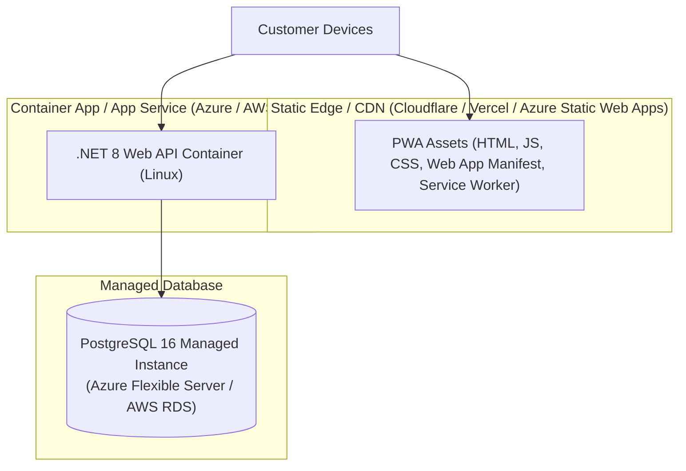

# 🚀 CI-CD & Deployment

This document covers continuous integration pipelines, automated quality gates, and target production deployment architectures.

---

## 1. Continuous Integration (`ci.yml`)

Every push and pull request to `main` and `pwa` triggers the GitHub Actions CI pipeline:

### Pipeline Jobs:
1. **Frontend Job**:
   - Ubuntu runner with Node.js 20.
   - Dependency verification (`npm ci`).
   - Linting check (`npm run lint`).
   - Unit test execution (`npm test`).
   - Production Vite PWA build (`npm run build`).
2. **Backend Job**:
   - Ubuntu runner with .NET 8.0.x SDK.
   - Runs unit tests in Release mode (`dotnet test`).

---

## 2. Production Hosting Architecture

### Hosting Strategy:
- **PWA Frontend**: Hosted as static assets on a global CDN (e.g., Cloudflare Pages or Vercel). High availability and instant delivery across the Philippines via edge PoPs (Manila / Cebu).
- **Backend Web API**: Packaged as a lightweight Linux container (`mcr.microsoft.com/dotnet/aspnet:8.0`) deployed to Azure Container Apps or AWS App Runner.
- **PostgreSQL**: Managed PostgreSQL 16 with daily automated backups.

---

## Related Notes
- [[Getting Started & Local Setup]] — Local development environment.
- [[Testing & QA Workflow]] — Running the local test suites.
- [[System Architecture]] — System component overview.
