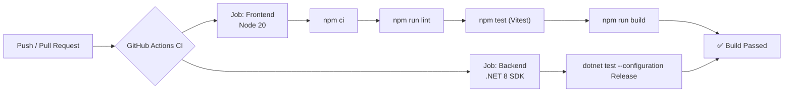
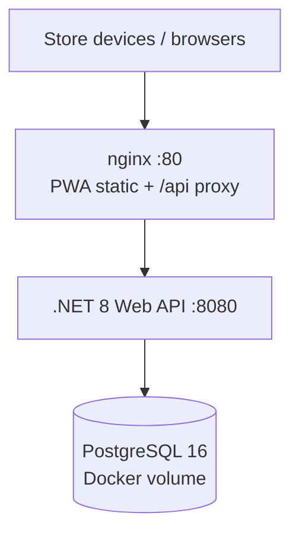
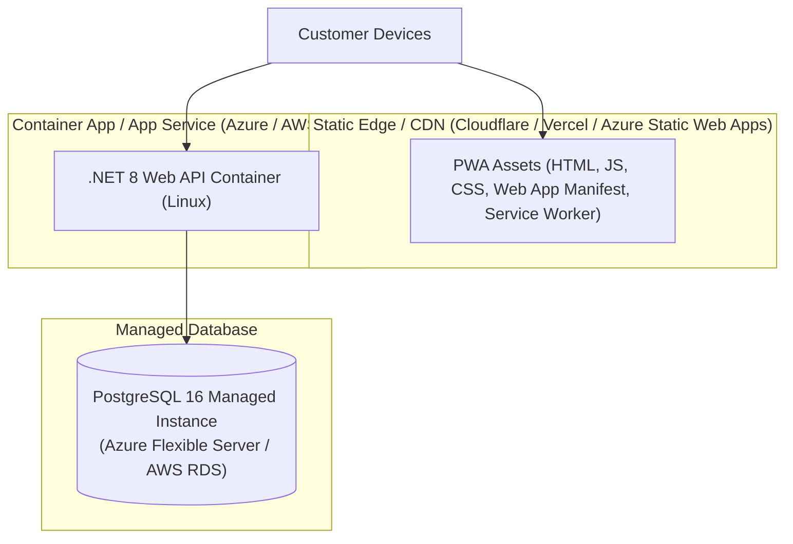

# 🚀 CI-CD & Deployment

This document covers continuous integration pipelines, automated quality gates, and target production deployment architectures (including Alibaba Cloud Simple Application Server).

---

## 1. Continuous Integration (`ci.yml`)

Every push and pull request to `main` and `pwa` triggers the GitHub Actions CI pipeline:



### Pipeline Jobs:
1. **Frontend Job**:
   - Ubuntu runner with Node.js 20.
   - Dependency verification (`npm ci`).
   - Linting check (`npm run lint`).
   - Unit test execution (`npm test`).
   - Production Vite PWA build (`npm run build`).
2. **Backend Job**:
   - Ubuntu runner with .NET 8.0.x SDK.
   - Runs unit tests in Release mode (`dotnet test`).

---

## 2. Alibaba Cloud Simple Application Server (SAS) — Novastack Standard

Primary production path for Novastack apps: one SAS instance running Docker Compose.



### Deploy target
| | |
| --- | --- |
| Public URL | `https://tindahan-dev.novastack-inc.online` |
| Unique host port | **8089** (shared SAS also uses 8086, 8087, 8088, 8090) |
| SAS host | `8.220.128.80` |

```bash
cp deploy/alibaba-sas.env.example deploy/alibaba-sas.env
# set POSTGRES_PASSWORD + PayMongo secrets

./deploy-alibaba-sas.sh --bootstrap   # first time
./deploy-alibaba-sas.sh               # ship updates
```

PowerShell: `./deploy-alibaba-sas.ps1` (`-Bootstrap` on first run).

| Piece | Role |
| --- | --- |
| `docker-compose.yml` | `db` + `api` + `web` stack used on SAS (`HOST_HTTP_PORT=8089`) |
| `deploy/nginx/default.conf` | App-container SPA fallback + `/api` reverse proxy |
| `deploy/nginx/host-vhost.conf.template` | Edge nginx: hostname → `127.0.0.1:8089` |
| `deploy/install-host-vhost.sh` | Installs vhost + optional certbot TLS |
| `deploy/alibaba-sas.env` | SSH target + production secrets (gitignored) |
| `deploy/remote-bootstrap.sh` | Idempotent Docker install on Ubuntu/Debian SAS |

Open TCP **8089**, **80**, and **443** in the SAS Firewall console. Health probe: `GET /api/health`.
### Local Docker parity
```bash
./run-local.sh --docker
# PWA http://localhost:8080  ·  API http://localhost:5000  ·  Postgres :5432
```

---

## 3. Alternate Hosting Architecture (CDN + managed DB)



### Hosting Strategy:
- **PWA Frontend**: Hosted as static assets on a global CDN when you outgrow single-node SAS.
- **Backend Web API**: Packaged as a lightweight Linux container (`mcr.microsoft.com/dotnet/aspnet:8.0`).
- **PostgreSQL**: Managed PostgreSQL 16 with daily automated backups.

---

## Related Notes
- [[Getting Started & Local Setup]] — Local development environment.
- [[Testing & QA Workflow]] — Running the local test suites.
- [[System Architecture]] — System component overview.
