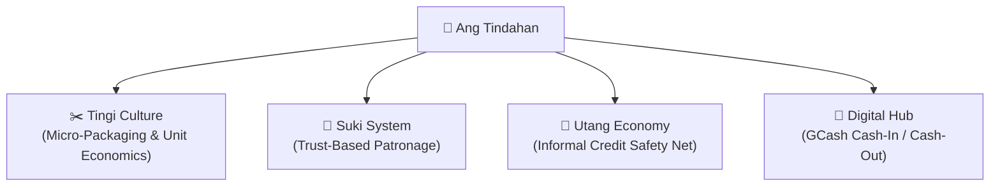

# 🇵🇭 Philippine Retail Culture & Ecosystem

With an estimated **1.3 million stores across the archipelago**, the **Sari-Sari Store** is the undisputed backbone of neighborhood commerce in the Philippines. Over **70% of Fast-Moving Consumer Goods (FMCG)** sales in the country flow through these family-operated micro-retail storefronts.

Understanding this social and cultural ecosystem is essential to designing software that store owners will actually adopt.

---

## 1. The Core Pillars of Sari-Sari Commerce

### A. The "Tingi" Culture (Micro-Packaging)
Because tens of millions of Filipinos earn daily wages (*"arawan"*), household budgets are constrained day-to-day. Consumers rarely purchase full boxes or bulk items:
- Shampoo and conditioner are bought in single-wash sachets.
- Cooking oil is ladled into tiny plastic ice bags (*"piso-pisong mantika"*).
- Cigarettes are purchased individually per stick (*"isang stick ng yosi"*).
- Coffee is sold in 3-in-1 single or twin-packs.

> [!IMPORTANT]
> A POS designed for standard Western grocery stores expects rigid barcode scans for prepackaged barcodes. Fluent Tindahan natively handles **tingi breakdowns** so an owner can buy a box wholesale and sell it stick-by-stick or sachet-by-sachet with accurate inventory decrements.

### B. The "Suki" System (Patronage & Social Capital)
A *suki* is more than a customer—they are a neighbor, relative, or long-time friend. Transactions are deeply relational:
- Store owners often greet customers by name, ask after their family, or grant small discounts or bonuses (*"tawad"* or *"dagdag"*).
- The store serves as the neighborhood information hub, community gossip corner (*"tsismisan"*), and social meeting point.

### C. The "Utang" Safety Net
The sari-sari store acts as an informal neighborhood bank. When families run short on cash before the 15th or 30th payday (*"kinsenas / katapusan"*), they ask to *"magpalista"* (charge on credit).
- The store owner assumes credit risk without interest charges because denying credit to neighbors can fracture community relationships.
- The greatest pain point is lost, illegible, or disputed notebooks (*"kwaderno"*).

### D. The Modern Digital Shift (GCash & E-Wallets)
In the last 5 years, sari-sari stores evolved from physical merchandise vendors into **neighborhood fintech agents**:
- OFW remittances, freelance payouts, and government subsidies (4Ps) arrive via GCash.
- Residents visit the tindahan to cash-out physical pesos or pay utility bills.
- Owners earn crucial supplementary income via convenience fees (₱10 - ₱50 per transaction).

---

## 2. Design Principles for Localized Software

1. **Zero Latency**: An owner ringing up customers through a window grill cannot wait 3 seconds for a cloud API call.
2. **Extreme Simplicity**: Touch targets must be generous and legible in bright sunlight and on budget Android phone screens.
3. **Respect for Privacy**: Customer debts must not be displayed conspicuously to passersby waiting outside the store.
4. **Tolerance for Unstable Power & Internet**: The application must remain fully functional during typhoons, power outages, and cellular blackouts.

---

## Related Notes
- [[Point of Sale (POS)]] — Operational checkout workflow.
- [[Inventory & Tingi]] — Margins and package breakdown mechanics.
- [[Utang Ledger]] — Digital debt management.
- [[GCash Agent System]] — E-wallet transaction handling.
