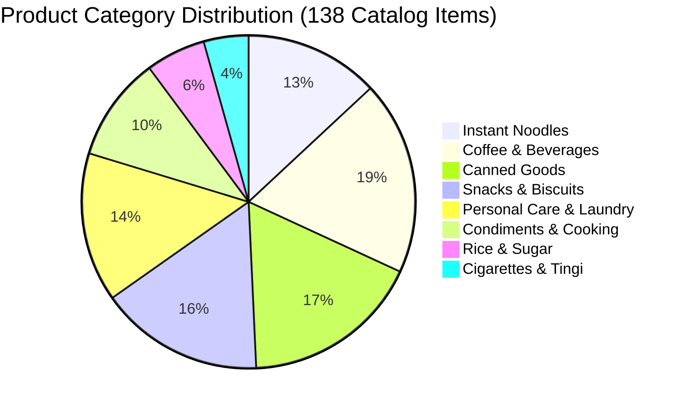

# 📋 Product Catalog Reference

Fluent Tindahan comes pre-loaded with a standardized Philippine FMCG catalog containing **138 authentic products** commonly found in sari-sari stores nationwide.

---

## 1. Major FMCG Manufacturers Represented

| Manufacturer | Core Brands in Catalog | Categories |
| :--- | :--- | :--- |
| **Monde Nissin** | Lucky Me!, Nissin Cup Noodles, Voice, Bingo | Instant Noodles, Biscuits |
| **Universal Robina (URC)** | Payless, Great Taste, Piattos, C2, Nova | Instant Noodles, Coffee, Snacks |
| **Nestlé Philippines** | Nescafé, Milo, Bear Brand, Maggi Magic Sarap | Coffee, Dairy, Beverages, Seasoning |
| **Kopiko (PT Mayora)** | Kopiko Blanca, Black, Brown, Cappuccino | Coffee |
| **Century Pacific Food** | Century Tuna, 555 Sardines, Birch Tree, Argentina | Canned Fish, Meat, Dairy |
| **San Miguel Foods** | Purefoods Corned Beef, Magnolia Dairy | Canned Meat |
| **Unilever Philippines** | Surf, Sunsilk, Dove, Knorr, Cream Silk | Laundry, Personal Care, Seasoning |
| **Procter & Gamble (P&G)** | Tide, Safeguard, Head & Shoulders, Pantene | Laundry, Personal Care |

---

## 2. Product Categories & Average Retail Margins

| Category | Typical Margin % | Reorder Frequency | Notes |
| :--- | :--- | :--- | :--- |
| **Instant Noodles** | 15% — 20% | 2x / week | High velocity staple; Lucky Me! Kalamansi is the #1 volume SKU. |
| **Coffee & Beverages** | 18% — 25% | 2x / week | Dominated by 3-in-1 twin packs (Kopiko Blanca, Great Taste White). |
| **Canned Goods** | 12% — 18% | 1x / week | Sardines (555, Ligo) and Corned Beef (Argentina) are emergency staples. |
| **Snacks & Biscuits** | 20% — 30% | 1x / week | High volume among neighborhood children (Piattos, SkyFlakes). |
| **Personal Care** | 22% — 35% | 1x / 2 weeks | Sold almost exclusively in single-use sachets (Surf, Sunsilk, Safeguard). |
| **Cigarettes (Tingi)** | 20% — 30% (stick) | 2x / week | Low pack margin (10-14%), but very high when broken down per stick. |
| **Rice & Grains** | 10% — 15% | 1x / week | Sold by the kilo or "ganta" from open sacks. |

---

## 3. Barcode Standard (EAN-13)

- **Country Prefix `480`**: Denotes products registered under GS1 Philippines.
- **Prefix `899`**: Denotes products imported from Indonesia (e.g., Kopiko).
- Items packaged for retail sale carry valid, factory-printed EAN-13 barcodes that scan instantly with USB and Bluetooth barcode readers.

---

## Related Notes
- [[Inventory & Tingi]] — Stock tracking and tingi package conversions.
- [[Point of Sale (POS)]] — Fast item lookup and scanning.
- [[Philippine Retail Culture]] — Consumer buying habits.
