# 🛒 Fluent Tindahan — Knowledge Base & Project Wiki

> **"An offline-first sari-sari store & GCash management system built for the realities of Philippine neighborhood commerce."**

Welcome to the internal engineering and domain knowledge base for **Fluent Tindahan**. This vault serves as the single source of truth for technical architecture, product specifications, domain mechanics, and developer workflows.

---

## 🗺️ Map of Content (MOC)

```mermaid
graph TD
    Home["🛒 Home (MOC)"]
    Arch["📐 01 - Architecture"]
    Domain["🏪 02 - Domains & Modules"]
    Tech["⚙️ 03 - Technical Reference"]
    Dev["🛠️ 04 - Developer Guides"]
    Eco["🇵🇭 05 - Sari-Sari Ecosystem"]

    Home --> Arch
    Home --> Domain
    Home --> Tech
    Home --> Dev
    Home --> Eco

    Arch --> SArch["[[System Architecture]]"]
    Arch --> Sync["[[Offline-First & Sync Engine]]"]
    Arch --> PWA["[[PWA & Service Worker]]"]
    Arch --> DB["[[Database Schemas]]"]

    Domain --> POS["[[Point of Sale (POS)]]"]
    Domain --> Inv["[[Inventory & Tingi]]"]
    Domain --> Utang["[[Utang Ledger]]"]
    Domain --> GCash["[[GCash Agent System]]"]
    Domain --> Dash["[[Dashboard & Analytics]]"]
    Domain --> Print["[[Thermal Printing & Hardware]]"]

    Tech --> API["[[Backend Web API]]"]
    Tech --> Front["[[Frontend Architecture & State]]"]
    Tech --> I18n["[[Internationalization (i18n)]]"]
    Tech --> Sec["[[Security & Privacy (RA 10173)]]"]

    Dev --> Setup["[[Getting Started & Local Setup]]"]
    Dev --> Test["[[Testing & QA Workflow]]"]
    Dev --> Deploy["[[CI-CD & Deployment]]"]

    Eco --> Retail["[[Philippine Retail Culture]]"]
    Eco --> Catalog["[[Product Catalog Reference]]"]
```

---

## 🧭 Vault Navigation

### 📐 [[01 - Architecture|01 — Architecture & Core Systems]]
Foundations of the offline-first distributed model between client PWA and server backend:
- [[System Architecture]] — Component layering, Clean Architecture in .NET 8, and React PWA client.
- [[Offline-First & Sync Engine]] — Dexie `syncQueue`, batching mutations, Last-Write-Wins, and Dead-Letter Queue (DLQ).
- [[PWA & Service Worker]] — Workbox precaching, dynamic chunk caching, update deferral during active cart, and multi-tab coordination.
- [[Database Schemas]] — Client-side IndexedDB Dexie tables vs PostgreSQL EF Core relational schema.

### 🏪 [[02 - Domains & Modules|02 — Business Domains & Store Operations]]
The core features designed specifically for Filipino neighborhood retailers:
- [[Point of Sale (POS)]] — Fast barcode search, integer centavos calculation, payment modal (Cash, GCash, Utang, Split), thermal receipt generation.
- [[Inventory & Tingi]] — SKU tracking, tingi fractional sales (per stick, per sachet), barcode lookup, stock replenishment, and CSV catalog imports.
- [[Utang Ledger]] — Append-only credit line tracking, customer balances, repayment records, and collection workflows.
- [[GCash Agent System]] — Cash-in/Cash-out transaction logging, automated service fee computation, reference numbers, and cash vs e-wallet balance tracking.
- [[Dashboard & Analytics]] — Real-time revenue, gross margin, top-selling FMCG products, and low-inventory restock alerts.
- [[Thermal Printing & Hardware]] — ESC/POS commands, 58mm/80mm receipt format, Web Bluetooth and Serial integration.

### ⚙️ [[03 - Technical Reference|03 — Technical Specifications]]
In-depth code, API, and architectural conventions:
- [[Backend Web API]] — Clean Architecture (.NET 8 Web API), MediatR CQRS commands/queries, FluentValidation, Swagger documentation.
- [[Frontend Architecture & State]] — Fluent UI React v9 design tokens, Griffel CSS-in-JS, Zustand state stores, and TanStack Query.
- [[Internationalization (i18n)]] — Dual-language support (English & Tagalog/Filipino), currency formatting (₱), and date/time formatting.
- [[Security & Privacy (RA 10173)]] — Compliance with the Philippine Data Privacy Act, Firebase Auth JWT validation, multi-tenant isolation.

### 🛠️ [[04 - Developer Guides|04 — Developer Onboarding & Workflows]]
Day-to-day commands, runbooks, and quality pipelines:
- [[Getting Started & Local Setup]] — Step-by-step dev environment setup, `start-local.ps1` script, and port configurations.
- [[Testing & QA Workflow]] — Vitest frontend tests (197+ tests), .NET 8 xUnit unit tests (36+ tests), and PWA multi-tab simulation.
- [[CI-CD & Deployment]] — GitHub Actions automation, Azure/Cloudflare hosting, containerization, and release steps.

### 🇵🇭 [[05 - Sari-Sari Store Ecosystem|05 — Sari-Sari Store Context]]
Background context on the informal Philippine retail landscape:
- [[Philippine Retail Culture]] — Understanding "tingi" economics, community trust in "utang", and the modern hybrid role of GCash cash-in/cash-out agents.
- [[Product Catalog Reference]] — Standard 138-item baseline catalog (Monde Nissin, Kopiko, Universal Robina, Nestle, San Miguel).

---

## ⚡ Quick Reference Card

| Item | Value / Location |
| :--- | :--- |
| **Frontend PWA** | `http://localhost:5173` (Dev) / `http://localhost:4173` (Preview) |
| **Backend API** | `http://localhost:5000` |
| **Swagger UI** | `http://localhost:5000/swagger` |
| **Health Check** | `http://localhost:5000/api/health` |
| **PostgreSQL Database** | `fluent_tindahan` (Port 5432) |
| **Primary Stack** | React + Vite + Fluent UI v9 + Dexie.js + .NET 8 + EF Core |
| **Design System** | Microsoft Fluent 2 (`@fluentui/react-components`) |

---

## 📝 Document Templates
When creating new notes, use the predefined templates:
- [[Feature Spec Template]]
- [[Bug Report Template]]
- [[Architecture Decision Record (ADR)]]
