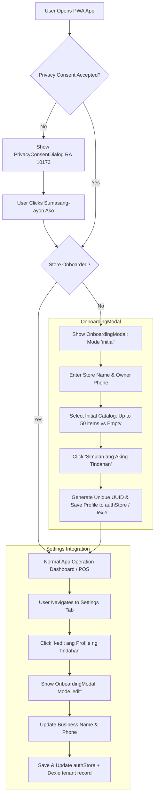

# Implementation Plan: Onboarding & Store Profile Setup Dialog

## Goal Description
Provide new Fluent Tindahan users with an intuitive, friendly, and accessible **Store Profile & Onboarding Dialog** on first launch, while giving existing users the ability to edit their store identity (Store Name, Owner Name, Contact Phone, and catalog preferences) from the Settings page.

This bridges the gap between the local-first "zero-friction" offline mode and multi-tenant identity, ensuring every store operator can personalize their *tindahan*, generate a unique tenant identifier, and choose their initial inventory setup.

---

## User Review Required

> [!IMPORTANT]
> **Tenant ID Migration on Initial Onboarding**:
> For a brand new device/user, the onboarding dialog will generate a unique client UUID (`crypto.randomUUID()`) for `tenantId` and `userId` (conforming to AGENTS.md Rule 5). If they choose the standard starter catalog, up to 50 products will be seeded directly with their unique `tenantId`, respecting the Libre tier limit.
>
> If a store already has existing transactions or data using `DEFAULT_TENANT_ID`, reopening the dialog in **Edit Mode** from Settings will only update profile metadata (`businessName`, `ownerName`, `userPhone`) to preserve relational integrity with existing Dexie sales and utang ledgers.

---

## Architecture & User Journey Flow



---

## Proposed Changes

### 1. State Management & Persistence (`frontend/src/state/authStore.ts`)

#### [MODIFY] `authStore.ts`
- Add persistent storage keys for:
  - `STORAGE_KEY_TENANT_ID = 'fluent_tindahan_tenant_id_v1'`
  - `STORAGE_KEY_USER_ID = 'fluent_tindahan_user_id_v1'`
  - `STORAGE_KEY_STORE_NAME = 'fluent_tindahan_store_name_v1'`
  - `STORAGE_KEY_OWNER_NAME = 'fluent_tindahan_owner_name_v1'`
  - `STORAGE_KEY_USER_PHONE = 'fluent_tindahan_user_phone_v1'`
  - `STORAGE_KEY_ONBOARDED = 'fluent_tindahan_onboarded_v1'`
- Add `isOnboarded: boolean` and `ownerName: string` to `AuthState`.
- Add `isOnboardingOpen: boolean` and `onboardingMode: 'initial' | 'edit'` to `AuthState`.
- Add actions:
  - `openOnboarding(mode?: 'initial' | 'edit')`
  - `closeOnboarding()`
  - `completeOnboarding(payload: { businessName: string; ownerName?: string; userPhone?: string; seedStandardCatalog: boolean })`
  - `updateStoreProfile(payload: { businessName: string; ownerName?: string; userPhone?: string })`

---

### 2. Database & Seed Catalog Configuration (`frontend/src/db/seedData.ts`)

#### [MODIFY] `seedData.ts`
- Update `seedDexieDatabaseIfNeeded(force = false, targetTenantId = DEFAULT_TENANT_ID, emptyCatalog = false)`:
  - Allows seeding up to 50 Philippine FMCG products with a custom `tenantId`, respecting the Libre tier limit.
  - Supports `emptyCatalog = true` if the user wants to start with a blank inventory.
  - Creates or updates the record in `db.tenants` matching the active `tenantId`.

---

### 3. Internationalization Dictionaries (`frontend/src/i18n/translations.ts`)

#### [MODIFY] `translations.ts`
- Add `onboarding` dictionary section for both Tagalog (`tl`) and English (`en`):
  - Modal title: `"I-setup ang Iyong Tindahan"` / `"Set Up Your Store"`
  - Subtitle: `"Maglagay ng pangalan at panimulang impormasyon para sa iyong tindahan."` / `"Enter your store name and details to get started."`
  - Store Name label, placeholder, error message for empty input.
  - Owner Name & Mobile Number fields.
  - Initial Catalog radio choices:
    - `"Karaniwang Paninda (hanggang 50 FMCG items)"` (Noodles, kape, de-lata, shampoo, etc.)
    - `"Malinis na Tindahan (Walang panimulang produkto)"`
  - Submit button: `"Simulan ang Aking Tindahan"` / `"Launch My Store"`
  - Edit profile button and labels for Settings page.

---

### 4. Onboarding Dialog Component (`frontend/src/components/OnboardingModal.tsx`)

#### [NEW] `OnboardingModal.tsx`
- Build an accessible Fluent UI v9 Dialog:
  - Uses `Dialog`, `DialogSurface`, `DialogTitle`, `DialogBody`, `DialogContent`, `DialogActions`.
  - Fields:
    - `Field` + `Input` for **Store Name** (mandatory, validated).
    - `Field` + `Input` for **Owner Name** (optional).
    - `Field` + `Input` for **Contact Phone Number** (validated with 11-digit `09...` pattern).
    - `RadioGroup` for **Panimulang Imbentaryo (Catalog Option)** (hidden or disabled in 'edit' mode).
  - Clean visual aesthetics:
    - Vibrant header with tindahan store icon and badge.
    - Smooth layout with Fluent tokens (`tokens.spacing*`, `tokens.color*`).
    - Informative helper texts in chosen language (Tagalog / English).
  - Handlers:
    - Validates inputs before committing.
    - Invokes `completeOnboarding` or `updateStoreProfile`.
    - Handles database seeding with the chosen tenant ID.

#### [NEW] `OnboardingModal.test.tsx`
- Unit tests verifying:
  - Dialog renders when `!isOnboarded` and consent has been accepted.
  - Validation displays error when store name is blank.
  - Successfully submits custom store name, phone, and updates `authStore` + `db.tenants`.
  - Edit mode works cleanly from settings without re-triggering catalog seed.

---

### 5. App Integration & Settings Page Integration

#### [MODIFY] `frontend/src/App.tsx`
- Render `<OnboardingModal />` alongside `<PrivacyConsentDialog />`.
- Ensure sequential display: `PrivacyConsentDialog` first, followed by `OnboardingModal`.

#### [MODIFY] `frontend/src/pages/SettingsPage.tsx`
- In the **Store & Device Details** card:
  - Add an **"I-edit ang Profile" / "Edit Store Profile"** button with `EditRegular` icon.
  - Clicking this triggers `openOnboarding('edit')`.
  - Displays Owner Name and Phone alongside Store Name, Tenant ID, and User ID.

---

## Verification Plan

### Automated Tests
1. **Run Unit Tests**:
   ```powershell
   cd frontend
   npm test -- --run
   ```
   Verify that all test suites pass, including new tests for `OnboardingModal.test.tsx` and updated `authStore.test.ts`.

2. **TypeScript Compilation & Build Verification**:
   ```powershell
   cd frontend
   npm run build
   ```
   Ensure zero TypeScript errors and clean bundling.

3. **Linter Check**:
   ```powershell
   cd frontend
   npm run lint
   ```

### Manual Verification
1. **First-time Onboarding Flow**:
   - Clear `localStorage` in browser dev tools.
   - Load app: Confirm `PrivacyConsentDialog` appears.
   - Accept privacy terms: Confirm `OnboardingModal` immediately appears.
  - Enter custom store name (e.g. *"Tindahan ni Ate Rose"*), phone (`09181234567`), select the standard catalog of up to 50 FMCG items.
   - Click "Simulan ang Aking Tindahan": Verify app loads with custom store name in the header.
  - Check POS and Inventory: Verify no more than 50 products are listed under the new store.
2. **Settings Edit Flow**:
   - Navigate to Settings -> Store & Device Details.
   - Click "I-edit ang Profile".
   - Change store name to *"Ate Rose Supermart & GCash"*.
   - Save: Confirm header and settings reflect the updated store name instantly.
3. **Language & Theme Switching**:
   - Switch language between Tagalog and English: Confirm all onboarding texts and validation messages change accordingly.
   - Switch between Light and Dark mode: Confirm contrast and Fluent UI surfaces look polished.
